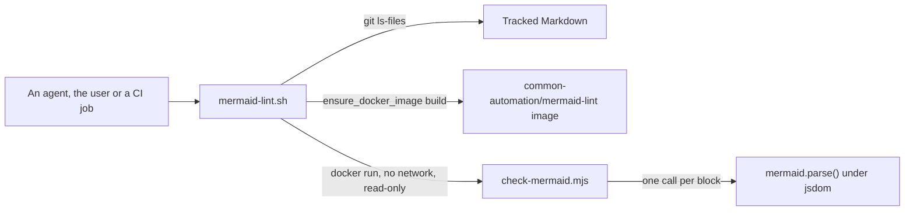
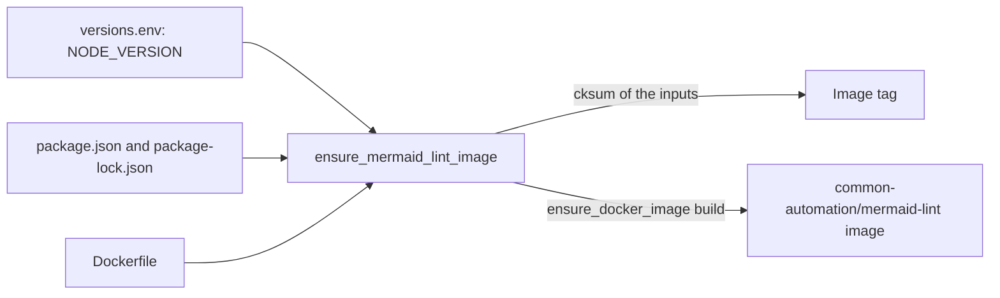
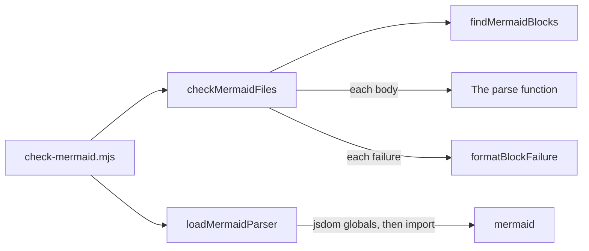
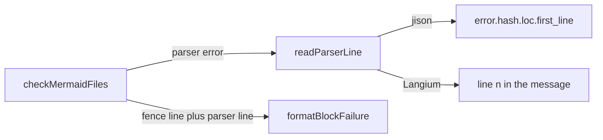
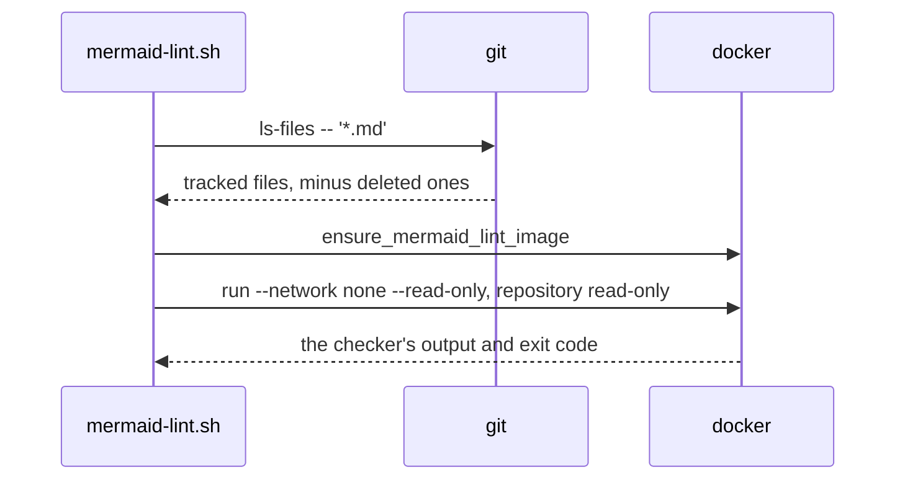
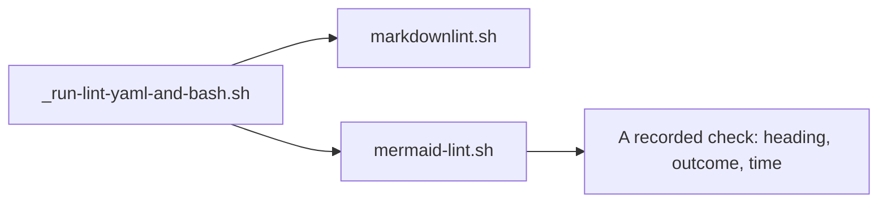
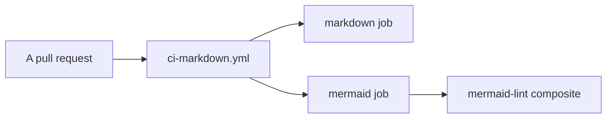
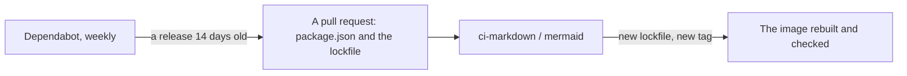
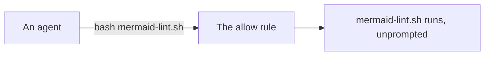
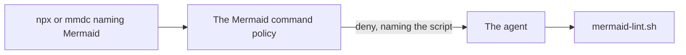

# Mermaid Lint

Issue: [#115](https://github.com/Klark-Morrigan/Common-Automation/issues/115)

- [Problem](#problem)
  - [What happened](#what-happened)
  - [What checks Markdown today](#what-checks-markdown-today)
  - [What it must be](#what-it-must-be)
- [Solution approach](#solution-approach)
  - [Candidates](#candidates)
  - [Where it runs in CI](#where-it-runs-in-ci)
  - [The spike](#the-spike)
  - [Spike results](#spike-results)
- [Design](#design)
  - [The run](#the-run)
  - [The image](#the-image)
  - [The checker](#the-checker)
  - [How the checker is tested](#how-the-checker-is-tested)
  - [Security](#security)
- [Affected files](#affected-files)
- [Steps](#steps)
  - [1. The mermaid-lint image builds from pinned Node, Mermaid and jsdom](#1-the-mermaid-lint-image-builds-from-pinned-node-mermaid-and-jsdom)
  - [2. The checker fails a Markdown file whose Mermaid block does not parse, naming the file and the block](#2-the-checker-fails-a-markdown-file-whose-mermaid-block-does-not-parse-naming-the-file-and-the-block)
  - [3. A Mermaid failure names the line inside the block where the parser stopped](#3-a-mermaid-failure-names-the-line-inside-the-block-where-the-parser-stopped)
  - [4. mermaid-lint.sh checks every Markdown file a repository tracks](#4-mermaid-lintsh-checks-every-markdown-file-a-repository-tracks)
  - [5. The local lint half runs the Mermaid check](#5-the-local-lint-half-runs-the-mermaid-check)
  - [6. Pull requests fail on a Mermaid block that does not parse](#6-pull-requests-fail-on-a-mermaid-block-that-does-not-parse)
  - [7. Dependabot proposes Mermaid and jsdom bumps](#7-dependabot-proposes-mermaid-and-jsdom-bumps)
  - [8. An agent runs the Mermaid check without a permission prompt](#8-an-agent-runs-the-mermaid-check-without-a-permission-prompt)
  - [9. An agent reaching for mermaid-cli is pointed at mermaid-lint.sh](#9-an-agent-reaching-for-mermaid-cli-is-pointed-at-mermaid-lintsh)

## Problem

Nothing checks that a Mermaid diagram parses before it is saved,
so a broken diagram is found only when someone opens the file and sees the error.
A check that runs Mermaid's own parser over every Markdown file would catch it when it is written.

### What happened

Plans and docs carry their diagrams as inline Mermaid,
and every plan step now holds one, so the number of diagrams grows with every plan.

Two diagrams written in one session failed to render, and the user found both:

- A label holding `&` looked like the cause, and was reworded.
- The diagram still failed: the node ID `call` is a Mermaid keyword, and that was the real cause.

The first fix was a guess, because nothing could run the parser and say which part failed.
Rules written down after the fact help only when they are remembered,
and they cover only the mistakes already made.

### What checks Markdown today

The [markdownlint action](../../../../.github/actions/markdownlint/README.md) checks a Markdown file's structure:
headings, lists, line breaks, fences.
It treats a fenced Mermaid block as opaque text, so a diagram that does not parse passes.

The editor's Mermaid preview shows the error, but only for a file someone opens,
and an agent cannot read it.

### What it must be

- **The real parser**: the same Mermaid parser that renders the diagram decides whether it parses,
  so no rule list has to keep up with Mermaid's grammar.
- **Precise**: a failure names the file, the line the block starts on, and the parser's message.
- **Same everywhere**: it runs the same way for an agent, for the user and in CI,
  as the markdownlint action does, over the Markdown a repository tracks.
- **No prompt**: an agent runs it through one narrow allow rule, with no code of its own to approve.
- **Contained**: nothing installed on the machine beyond what the markdownlint action already needs,
  and no network access while it runs.
- **Cheap**: a file with no Mermaid block costs next to nothing,
  and a run over a whole repository stays within a few seconds once its tooling is in place.

## Solution approach

Let Mermaid's own parser decide; write no parser.

**Direction: a thin checker in this repository**
that hands every Mermaid block to `mermaid.parse()` under jsdom,
in one Node process per run.
The checker only finds the blocks and maps the parser's line onto the file;
whether a block parses is Mermaid's verdict.

- It is the only candidate that meets every point of [What it must be](#what-it-must-be):
  the real parser decides, a failure names the file and the line, and a run over a repository takes about two seconds.
- mermaid-cli uses the real parser too,
  but it starts a browser for every file, its image is 2.2 GB,
  and its message names neither the file nor the block.
- `@mermaid-lint/cli` passes the diagram that must fail:
  a reimplemented grammar answers first, and Mermaid's parser runs only on what that grammar rejects.

### Candidates

| Candidate | Who decides | Weight | Verdict |
| --- | --- | --- | --- |
| [mermaid-cli](https://github.com/mermaid-js/mermaid-cli) (`mmdc`) in its official image [`minlag/mermaid-cli`](https://hub.docker.com/r/minlag/mermaid-cli) | The renderer itself, in headless Chromium | 2.2 GB unpacked; a browser start per file | Qualifies; heavy, slow per file, imprecise message |
| [`@mermaid-lint/cli`](https://www.npmjs.com/package/@mermaid-lint/cli), one maintainer | merman, a Rust reimplementation of the grammar; `mermaid.parse()` only when merman rejects | 329 MB image and 163 MB of packages | Fails: merman accepts the keyword node ID |
| A checker in this repository calling `mermaid.parse()` under [jsdom](https://github.com/jsdom/jsdom) | Mermaid's parser, without rendering | 714 MB image, packages included | Qualifies; the direction |

Left out:

- [`@mermaid-js/parser`](https://socket.dev/npm/package/@mermaid-js/parser) covers only the diagram types Mermaid has moved to its newer grammars,
  per [Mermaid's guide](https://mermaid.js.org/community/new-diagram.html), and flowcharts are not among them.
- [`mermaid-check`](https://pkg.go.dev/github.com/sammcj/mermaid-check), [merman](https://docs.rs/crate/merman/0.6.0/source/README.md)
  and [Maid](https://awesome.ecosyste.ms/projects/github.com%2Fprobelabs%2Fmaid) reimplement the grammar,
  so what they accept can drift from what Mermaid renders.
- Installing mermaid-cli on a GitHub-hosted runner, using the runner's Chrome,
  needs the network on every run, differs from a local run,
  and fails on a self-hosted runner without Chrome.

### Where it runs in CI

In [ci-markdown.yml](../../../../.github/workflows/ci-markdown.yml), not a workflow of its own:
the check reads Markdown, which is that workflow's subject.
It runs as a second job beside `markdown`, from a new composite `.github/actions/mermaid-lint/`
beside `markdownlint/`, so that:

- a diagram failure shows as its own `ci-markdown / mermaid` check row;
- a heavier image does not hold up markdownlint, since the jobs run in parallel;
- it carries a timeout of its own.

### The spike

Run each candidate against the three diagrams below, each in a fenced `mermaid` block of a Markdown file of its own.
They are written here in `text` fences so this plan's own diagrams stay valid.

A node ID that is a Mermaid keyword; must fail:

```text
flowchart LR
    session[A session] -->|loads| skill[A skill]
    skill -->|shows the call| call[A script call]
    call --> resolver[auto-allow resolver]
```

A label holding `&`; record what each candidate does with it:

```text
flowchart LR
    skill -- shows the call --> scriptCall["& Get-FileLineCounts.ps1 ..."]
    scriptCall --> resolver[auto-allow resolver]
```

A valid diagram; must pass:

```text
flowchart LR
    session[A session] -->|loads| skill[A skill]
    skill -->|shows the call| scriptCall[A script call]
    scriptCall --> resolver[auto-allow resolver]
```

A candidate qualifies when it fails the first file and passes the third.

### Spike results

Every candidate ran in a container with read-only mounts and its network off,
and each one ran fine that way.
The third candidate ran as a prototype of [the checker](#the-checker).

| | mermaid-cli | `@mermaid-lint/cli` | Checker prototype |
| --- | --- | --- | --- |
| Version | mmdc 12.0.0, Mermaid 12.2.0, `minlag/mermaid-cli@sha256:18938e53497376d524e04b1fc0bf7b6d61a491ce9ff7032bb2855d57155acb10` | 0.53.1, Mermaid 11.16.1 | Mermaid 12.2.0, jsdom 30.1.3, `node:22-bookworm-slim@sha256:e9f565d32859f0cbfb52125eafe8be39390f24dac302dc3cdf566e8ba3ab21ee` (Node 22.23.5) |
| Exit codes, files 1 to 3 | 1, 0, 0 | 0, 0, 0 | 1, 0, 0 |
| Failure message | Mermaid's message and a browser stack trace; the line counts from the diagram's first line; no file, no block | None | Mermaid's message, under the file and the fence line |
| Wall time | 3.4 s for the three files | 2.4 to 2.8 s for the three files | 1.2 to 1.7 s for six files and eight blocks |
| Size | 2.2 GB | 329 MB and 163 MB | 714 MB |

What the runs showed:

- A label holding `&` parses in every candidate, so it was never a cause.
- merman answered valid for the keyword diagram; `mermaid.parse()` alone rejected it at line 4.
- Mermaid has two parser families, and they report the line in different places:
  jison in `error.hash.loc.first_line`, Langium only in its message (`Parse error on line 3, column 12`).
  Both count from the diagram's first line.
- A `sequenceDiagram` with a `box` parses only when jsdom's `Option` is a global.
- Loading the packages through a bind mount from Windows took 68 s; installed in the image, 0.5 s.
- Over whole repositories the prototype took 2.0 s for this one (15 files, 21 blocks)
  and 1.7 s for a consumer (64 files, 9 blocks), and every block parsed.

## Design

### The run



`mermaid-lint.sh` in `.github/actions/mermaid-lint/` is the one entry point,
so an agent, the user and CI run the same thing,
and an agent needs one allow rule naming the script, as for `markdownlint.sh`.

It finds files the way [`markdownlint.sh`](../../../../.github/actions/markdownlint/markdownlint.sh) does:

- `git ls-files -- '*.md'` in the current directory, outside a work tree an error;
- a tracked file missing from the work tree is skipped;
- no tracked Markdown is a `::notice::` and exit 0.

It mounts the repository read-only and passes every file to one checker process.
No Common-Automation mount is needed, since the check reads no config.

### The image

`common-automation/mermaid-lint:<tag>` is built from a Dockerfile in the action folder,
through `ensure_docker_image … build`, as yamllint's image is.

- **Base**: `node:${NODE_VERSION}-bookworm-slim`, with `NODE_VERSION` added to `versions.env`.
- **Packages**: `package.json` in the action folder pins `mermaid` and `jsdom` to exact versions,
  and `package-lock.json` pins every package beneath them with an integrity hash.
  npm's own files hold these pins, so `versions.env` does not repeat them.
- **Install**: `npm ci --ignore-scripts` at build time, so no package's install script runs,
  and a run needs no network.
- **Layers**: the lockfile and `npm ci` come first and the checker last,
  so a checker edit rebuilds in seconds.
- **Tag**: `<mermaid version>-<checksum>`,
  the checksum being `cksum` over the Dockerfile, the lockfile, the checker's sources and `NODE_VERSION`,
  as the bats image's tag is `cksum` over its Dockerfile.
  `ensure_docker_image` caches by tag, so a change to any build input builds anew,
  and an unchanged image costs one `docker image inspect`.
- **Bumps**: Dependabot proposes them.
  `.github/dependabot.yml` holds one `npm` entry for `/.github/actions/mermaid-lint`:
  weekly, `cooldown: default-days: 14` so a pin is a release at least two weeks old,
  and one group, so `mermaid` and `jsdom` move in one pull request.
  Dependabot updates `package.json` and the lockfile together.
  Its pull request runs the `ci-markdown / mermaid` gate,
  and since the lockfile feeds the image tag, that gate builds and checks against the new packages.
  A bump by hand edits `package.json`,
  then regenerates the lockfile inside the pinned Node image with `npm install --package-lock-only --ignore-scripts`;
  the action's README holds the command.
  The file is created by whichever lands first, this plan or the
  [action pins plan](../128-dependabot-action-pins/plan.md), and the other adds its entry.

**Where the pins live**: `versions.env` stops being the only home of tool versions,
so each home names the other, and the READMEs say which pin lives where.

- `versions.env`'s header says it holds every pin but the checker's npm packages,
  and names `.github/actions/mermaid-lint/package.json` as their home.
- JSON holds no comments, so the links back from `package.json` sit beside it:
  the Dockerfile's header names `versions.env` for `NODE_VERSION`,
  and the action's README has a **Versions** section
  naming the three pins, the file each lives in, and the bump command for each.
- The repository README gains a **Tool versions** section under Local development:
  one table of every pinned tool, the key or file that pins it, and a link to it.
  Its Layout entry for `versions.env` no longer calls the file the single source of truth.

### The checker

`check-mermaid.mjs` takes file paths as arguments, relative to the working directory.

**A block** opens on a line holding any indentation, three or more backticks or tildes,
and an info string whose first word is `mermaid`.
It closes on the first later line holding only that fence character,
at least as many times, after any indentation,
or at the end of the file.
The body loses the opening fence's indentation, so fences inside list items work.
Fences inside block quotes are not recognised.

**Parsing**: jsdom's `window`, `document` and `Option` become globals before Mermaid is imported:
DOMPurify needs a window when Mermaid loads,
and the sequence diagram's `box` parser names `Option`.
Each body then goes to `mermaid.parse()`, and a throw is a failure.

**A failure** prints as:

```text
<file>:<line>: Mermaid block at line <fence line> does not parse
    <the parser's message, each line indented four spaces>
```

- `<line>` is the fence line plus the parser's line,
  read from jison's `error.hash.loc.first_line`, else from Langium's `line <n>` in the message.
  When neither is there, it is the fence line.
- The `<file>:<line>` form opens at the line in an editor or a terminal.
- The run ends with `Checked <n> Mermaid block(s) in <n> file(s); <n> failed.`

**Exit codes**:

| Code | Meaning |
| --- | --- |
| 0 | Every block parses, or there is none |
| 1 | A block does not parse |
| 2 | No file was given, or a file cannot be read |

**No options**: every argument is a path, so a file named like a flag is still a file.

### How the checker is tested

- **One function per file** under `checker/`.
  A function takes what it reads (a file's text, a parser error) or its collaborators (`readFile`, `parse`, `write`)
  as arguments, so its unit suite needs neither Mermaid nor a container.
- **Node's own runner**: each function has a `node:test` suite beside it, `<name>.test.mjs`,
  and no test package joins the lockfile.
- **Into the bats run**: one bats integration case runs `node --test` over `checker/` inside the image,
  so CI's bats job runs the suites with no new workflow or runner.
  The local test half runs bats in a container with no Docker, so there that case skips,
  as every image-backed case does;
  `node --test .github/actions/mermaid-lint/checker/` on the host runs the suites directly.
- **The real parser in integration cases**: fixtures under `checker/fixtures/` run through `check-mermaid.mjs` in the image,
  one case per behaviour, with the network off and the container read-only.
- **Fixtures are `.txt`**: several hold diagrams that must fail,
  and the `ci-markdown / mermaid` job checks every tracked `.md` file, so a `.md` fixture would fail this repository's own gate.
  The checker reads any path as Markdown, so the extension changes nothing in what a case checks.

### Security

- The repository is mounted read-only and the container runs with `--read-only` and `--network none`,
  so a compromised package can neither change the checkout nor send anything out.
- Install scripts never run, and the lockfile's integrity hashes reject a tampered package.
- `mermaid.parse()` never renders, and jsdom runs no scripts by default,
  so a diagram's labels are never evaluated as HTML.

## Affected files

| File | Change |
| --- | --- |
| [README.md](../../../../README.md) | A **Tool versions** section under Local development; the lint half's list and the ci-markdown section name the Mermaid check; the Layout tree gains `mermaid-lint/` and stops calling `versions.env` the single source of truth |
| [.github/lib/versions.env](../../../../.github/lib/versions.env) | `NODE_VERSION`; the header names the checker's `package.json` as the home of its npm pins |
| [.github/workflows/ci-markdown.yml](../../../../.github/workflows/ci-markdown.yml) | A `mermaid` job beside `markdown` |
| [scripts/_run-lint-yaml-and-bash.sh](../../../../scripts/_run-lint-yaml-and-bash.sh) | Runs `mermaid-lint.sh` after markdownlint |
| [scripts/_run-lint-yaml-and-bash.bats](../../../../scripts/_run-lint-yaml-and-bash.bats) | Expects the `mermaid-lint` heading in the check list |

New files, all under `.github/actions/mermaid-lint/` but the last:

- `action.yml`, `mermaid-lint.sh` and `mermaid-lint.bats`, in the shape every action takes;
- `README.md`, with its **Versions** section;
- `Dockerfile`, `.dockerignore`, `package.json` and `package-lock.json`;
- `ensure-mermaid-lint-image.sh` and `ensure-mermaid-lint-image.bats`;
- `checker/`: one function per `.mjs` file, each with its `.test.mjs`;
  `check-mermaid.mjs`, the entry;
  `check-mermaid.integration.bats` and `node-tests.integration.bats`;
  `fixtures/`, the diagrams the integration cases read, as `.txt` files;
- `.github/dependabot.yml`, unless the [action pins plan](../128-dependabot-action-pins/plan.md) has created it.

Outside this repository, in the agent tooling, steps 8 and 9 change the allow list, the settings notes and both policy lists,
and add the Mermaid command policy with its bats suite.

## Steps

Every step lands with its own tests and with the README text its change makes true;
a step is not done without them.

### 1. The mermaid-lint image builds from pinned Node, Mermaid and jsdom

**Problem.** The checker needs Mermaid and jsdom with no network at run time,
and nothing pins or packages them yet.

**Solution.** The image as [The image](#the-image) sets it out:

- `NODE_VERSION=22.23.5` in `versions.env`, and its header naming the checker's npm pins' home.
- `package.json` pinning `mermaid` 12.2.0 and `jsdom` 30.1.3 exactly,
  and `package-lock.json` generated in the pinned Node image.
- `Dockerfile`: `ARG NODE_VERSION`, the slim Node base, the package files, then `npm ci --ignore-scripts`;
  its header names `versions.env`.
  `.dockerignore` keeps tests, fixtures and bats suites out of the image.
- `ensure-mermaid-lint-image.sh`, sourced, defines `ensure_mermaid_lint_image`:
  it works out the tag, builds through `ensure_docker_image` when no image holds it, and prints the image name.
- The action's README with its **Versions** section,
  and the repository README's **Tool versions** section and Layout entries.



**Verification** (`ensure-mermaid-lint-image.bats`, 15 s, the first build aside).
Integration: given the action folder,
when `ensure_mermaid_lint_image` runs and the image's Node imports Mermaid with the network off,
then it prints `12.2.0`.

**Test cases** (`ensure-mermaid-lint-image.bats`, a new suite, 15 s: every case starts the script against a stubbed `docker`):

- Given an image already holds the tag, when it runs, then no build runs and it prints the image name.
- Given no image holds the tag, when it runs, then it builds with `--build-arg NODE_VERSION=22.23.5` and `-t` the tag.
- Given the lockfile changes by one byte, when it runs, then the tag changes.
- Given `NODE_VERSION` changes, when it runs, then the tag changes.
- Given `package.json` pins Mermaid 12.2.0, when it runs, then the tag starts with `12.2.0-`.

### 2. The checker fails a Markdown file whose Mermaid block does not parse, naming the file and the block

**Problem.** Nothing hands a Markdown file's Mermaid blocks to Mermaid's parser.

**Solution.** Under `checker/`, one function per file, as [How the checker is tested](#how-the-checker-is-tested) sets out:

- `find-mermaid-blocks.mjs`: `findMermaidBlocks(text)` returns each block's fence line and body,
  by the block rule in [The checker](#the-checker).
- `format-block-failure.mjs`: `formatBlockFailure(file, line, fenceLine, message)` returns the failure text.
- `check-mermaid-files.mjs`: `checkMermaidFiles(paths, { readFile, parse, write })` parses every block,
  writes each failure and the closing summary, and returns the exit code.
- `load-mermaid-parser.mjs`: `loadMermaidParser()` sets jsdom's globals, imports Mermaid and returns its parse function.
- `check-mermaid.mjs`, the entry: wires the real collaborators and sets the exit code.
- The Dockerfile copies `checker/` in last.

A failure's line is the fence line in this step; step 3 adds the parser's line to it.



**Verification** (`checker/check-mermaid.integration.bats`, a new suite, 15 s: every case starts one container).
Integration: given the spike's keyword diagram in a fixture,
when `check-mermaid.mjs` runs on it in the image, read-only with the network off,
then it exits 1 and prints `keyword-node-id.txt:5: Mermaid block at line 5 does not parse`.

**Test cases** (`checker/check-mermaid.integration.bats`):

- Integration: given the spike's valid diagram, when checked, then it exits 0.
- Integration: given the spike's `&` label diagram, when checked, then it exits 0.
- Integration: given a `sequenceDiagram` with a `box`, when checked, then it exits 0, since `Option` is a global.
- Integration: given a file with no Mermaid block, when checked, then it exits 0 and prints `Checked 0 Mermaid block(s) in 1 file(s); 0 failed.`
- Integration: given a file that does not exist, when checked, then it exits 2 and names the file.

**Test cases** (`checker/node-tests.integration.bats`, a new suite, 5 s: one case, one container).
Integration: given the checker's `node:test` suites, when `node --test` runs over `checker/` in the image,
then every suite passes, and a failing one is named in the output.
The `node:test` suites it runs, each a new suite under 1 s with no process started:

- `find-mermaid-blocks.test.mjs`:
  - given a backtick fence, then one block with its fence line and body;
  - given a tilde fence, then one block;
  - given a four-backtick fence, then a three-backtick line inside it does not close it;
  - given an indented fence in a list item, then the body loses that indentation;
  - given the info string `mermaid title`, then a block; given `mermaidx`, then none;
  - given a fence never closed, then the block runs to the end of the file;
  - given CRLF line endings, then the body holds no carriage returns;
  - given a `text` fence, then none;
  - given a fence inside a block quote, then none.
- `format-block-failure.test.mjs`:
  - given a file, a line, a fence line and a two-line message,
    then the header line and both message lines, each indented four spaces.
- `check-mermaid-files.test.mjs`, with fake `readFile`, `parse` and `write`:
  - given every block parses, then 0 and the summary;
  - given one parse throws, then 1, its failure and a summary counting it;
  - given two failing blocks in one file, then both failures, in file order;
  - given `readFile` throws, then 2 and the file named;
  - given no paths, then 2;
  - given a path that starts with `-`, then it is read as a file.

### 3. A Mermaid failure names the line inside the block where the parser stopped

**Problem.** A failure points at the fence, so a long diagram leaves the reader to find the line.

**Solution.**

- `checker/read-parser-line.mjs`: `readParserLine(error)` returns the line inside the block,
  read the two ways [The checker](#the-checker) names, or nothing.
- `checkMermaidFiles` reports the fence line plus that line, or the fence line when there is none.



**Verification** (`checker/check-mermaid.integration.bats`, 2 s, one more container).
Integration: given the spike's keyword diagram,
when checked, then it prints `keyword-node-id.txt:9: Mermaid block at line 5 does not parse`.

**Test cases**:

- `checker/check-mermaid.integration.bats`, 2 s a case, one container each:
  - integration: given a broken `pie` chart, a Langium diagram, when checked, then its line is the fence line plus the parser's;
  - integration: given two blocks where only the second fails, when checked, then only the second is reported, at its own line.
- `read-parser-line.test.mjs`, a new suite under 1 s:
  - given a jison error with `hash.loc.first_line` 4, then 4;
  - given a Langium message `Parse error on line 3, column 12`, then 3;
  - given an error with neither, then nothing.
- `check-mermaid-files.test.mjs`, under 1 s more:
  - given parser line 4 in a block fenced at line 5, then line 9;
  - given no parser line, then the fence line.

### 4. mermaid-lint.sh checks every Markdown file a repository tracks

**Problem.** The checker runs only on paths handed to it inside the image;
nothing finds a repository's Markdown or starts the container.

**Solution.**

- `mermaid-lint.sh` as [The run](#the-run) sets out:
  it finds the tracked Markdown, calls `ensure_mermaid_lint_image`,
  and runs `check-mermaid.mjs` over every file in one container,
  read-only with the network off, the repository mounted read-only.
  Its exit code is the checker's.
- `action.yml`, the composite that runs it, as markdownlint's does.
- The action's README: what it checks, how to run it, its exit codes.



**Verification** (`mermaid-lint.bats`, a new suite, 15 s: every case starts the script; integration cases start one container).
Integration: given a git repository tracking a Markdown file that holds the spike's keyword diagram,
when `mermaid-lint.sh` runs in it, then it exits 1 and names that file at line 9.

**Test cases** (`mermaid-lint.bats`):

- Given a folder that is not a git work tree, then it fails naming the folder.
- Given git tracks no Markdown, then a `::notice::` and exit 0.
- Given every tracked Markdown file is deleted from the work tree, then it skips.
- Given a stubbed `docker`, then the run passes `--network none` and `--read-only` and mounts the repository read-only.
- Given an untracked Markdown file beside a tracked one, then only the tracked one is passed.
- Given the stubbed checker exits 1, then the script exits 1.
- Integration: given a repository whose diagrams all parse, then it exits 0.

### 5. The local lint half runs the Mermaid check

**Problem.** `run-ci-yaml-and-bash.sh` promises what CI runs, and CI is about to run the Mermaid check.

**Solution.**

- `scripts/_run-lint-yaml-and-bash.sh` runs `mermaid-lint.sh` as a recorded check after markdownlint.
- The README's list of what the lint half runs names it.



**Verification** (`scripts/_run-lint-yaml-and-bash.bats`, 2 s, one more check stubbed).
Given a target repository, when the lint half runs,
then `=== mermaid-lint ===` follows `=== markdownlint ===` and a failure of it is named in the summary.

**Test cases** (`scripts/_run-lint-yaml-and-bash.bats`):
the three cases that list every check expect `mermaid-lint` after `markdownlint`.

### 6. Pull requests fail on a Mermaid block that does not parse

**Problem.** The check runs only when someone starts it,
so a broken diagram can still merge.

**Solution.**

- `ci-markdown.yml` gains a `mermaid` job beside `markdown`, as [Where it runs in CI](#where-it-runs-in-ci) sets out:
  the same runner selection and read-only token,
  the caller checked out, Common-Automation's `.github/actions` and `.github/lib` staged,
  then the `mermaid-lint` composite.
  `timeout-minutes: 15`, about ten times a run that builds the image.
- The workflow's header and the README's ci-markdown section name both jobs.



**Verification.** The harness is GitHub Actions, on the step's own pull request:
the `ci-markdown / mermaid` job checks every Markdown file the repository tracks, this plan's diagrams included,
and passes.
That the job fails on a broken diagram is step 4's to show, in `mermaid-lint.bats`.

**Test cases.** None beyond the gates that already cover workflow files: actionlint and action-validator in `ci-yaml`.

### 7. Dependabot proposes Mermaid and jsdom bumps

**Problem.** The npm pins move only when someone bumps them by hand.

**Solution.**

- `.github/dependabot.yml` with the `npm` entry [The image](#the-image) sets out,
  created here unless the [action pins plan](../128-dependabot-action-pins/plan.md) has created it.
- The README's **Tool versions** table says Dependabot proposes the npm pins.



**Verification.** yamllint in `ci-yaml` checks the file's syntax,
and the repository's Dependabot page shows the `npm` entry with no configuration error.

**Test cases.** None: the file holds no logic of its own.

### 8. An agent runs the Mermaid check without a permission prompt

**Problem.** An agent's call to `mermaid-lint.sh` prompts until an allow rule names it,
which [What it must be](#what-it-must-be) rules out.

**Solution.**

In the agent tooling, outside this repository, each change beside its markdownlint counterpart:

- The allow list gains `Bash(bash /c/a_Code/Common-Automation/.github/actions/mermaid-lint/mermaid-lint.sh)`:
  the absolute path, so only that one file matches.
- The settings notes' row for the Common-Automation lint scripts names `mermaid-lint.sh` among them.
- The settings file is protected, so the agent writes the rule and the user approves the write.
- The policy that turns away a relative `.github/actions/` call already covers `mermaid-lint.sh`, and needs no change.



**Verification.** An agent session runs `bash /c/a_Code/Common-Automation/.github/actions/mermaid-lint/mermaid-lint.sh`
from a repository's root, and no prompt appears.

**Test cases.** None in this repository.

### 9. An agent reaching for mermaid-cli is pointed at mermaid-lint.sh

**Problem.** An agent checking a diagram reaches for `npx @mermaid-js/mermaid-cli` or `mmdc`.
That runs whatever copy npm resolves, outside the pinned image and with the network on,
and an allow rule on `npx` would cover any package.

**Solution.** In the agent tooling, outside this repository:

- A command policy beside the markdownlint one denies `npx` naming a Mermaid package,
  and `mmdc` at command position,
  with a reason naming `bash /c/a_Code/Common-Automation/.github/actions/mermaid-lint/mermaid-lint.sh`,
  run from the repository's root.
- Both policy lists register it, as they register the markdownlint policy.



**Verification** (the policy's bats suite, a new suite, 5 s: every case calls one function, with no process started).
Given the command `npx -p @mermaid-js/mermaid-cli mmdc -i plan.md`, when the policy reads it,
then it denies, and the reason names `mermaid-lint.sh`.

**Test cases** (the policy's bats suite):

- Given `npx @mermaid-lint/cli docs`, then it denies.
- Given `rtk npx -p @mermaid-js/mermaid-cli mmdc`, then it denies.
- Given a bare `mmdc -i plan.md`, or `mmdc.cmd`, then it denies.
- Given `bash /c/a_Code/Common-Automation/.github/actions/mermaid-lint/mermaid-lint.sh`, then it allows.
- Given `cat docs/mermaid.md`, then it allows, since the word is part of a path.
