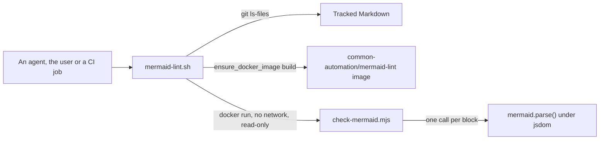

# Mermaid Lint

Issue: [#115](https://github.com/Klark-Morrigan/Common-Automation/issues/115)

- [Problem](#problem)
  - [What happened](#what-happened)
  - [What checks Markdown today](#what-checks-markdown-today)
  - [What it must be](#what-it-must-be)
- [Solution approach](#solution-approach)
  - [Candidates](#candidates)
  - [Where it runs in CI](#where-it-runs-in-ci)
  - [The spike](#the-spike)
  - [Spike results](#spike-results)
- [Design](#design)
  - [The run](#the-run)
  - [The image](#the-image)
  - [The checker](#the-checker)
  - [Security](#security)

## Problem

Nothing checks that a Mermaid diagram parses before it is saved,
so a broken diagram is found only when someone opens the file and sees the error.
A check that runs Mermaid's own parser over every Markdown file would catch it when it is written.

### What happened

Plans and docs carry their diagrams as inline Mermaid,
and every plan step now holds one, so the number of diagrams grows with every plan.

Two diagrams written in one session failed to render, and the user found both:

- A label holding `&` looked like the cause, and was reworded.
- The diagram still failed: the node ID `call` is a Mermaid keyword, and that was the real cause.

The first fix was a guess, because nothing could run the parser and say which part failed.
Rules written down after the fact help only when they are remembered,
and they cover only the mistakes already made.

### What checks Markdown today

The [markdownlint action](../../../../.github/actions/markdownlint/README.md) checks a Markdown file's structure:
headings, lists, line breaks, fences.
It treats a fenced Mermaid block as opaque text, so a diagram that does not parse passes.

The editor's Mermaid preview shows the error, but only for a file someone opens,
and an agent cannot read it.

### What it must be

- **The real parser**: the same Mermaid parser that renders the diagram decides whether it parses,
  so no rule list has to keep up with Mermaid's grammar.
- **Precise**: a failure names the file, the line the block starts on, and the parser's message.
- **Same everywhere**: it runs the same way for an agent, for the user and in CI,
  as the markdownlint action does, over the Markdown a repository tracks.
- **No prompt**: an agent runs it through one narrow allow rule, with no code of its own to approve.
- **Contained**: nothing installed on the machine beyond what the markdownlint action already needs,
  and no network access while it runs.
- **Cheap**: a file with no Mermaid block costs next to nothing,
  and a run over a whole repository stays within a few seconds once its tooling is in place.

## Solution approach

Let Mermaid's own parser decide; write no parser.

**Direction: a thin checker in this repository**
that hands every Mermaid block to `mermaid.parse()` under jsdom,
in one Node process per run.
The checker only finds the blocks and maps the parser's line onto the file;
whether a block parses is Mermaid's verdict.

- It is the only candidate that meets every point of [What it must be](#what-it-must-be):
  the real parser decides, a failure names the file and the line, and a run over a repository takes about two seconds.
- mermaid-cli uses the real parser too,
  but it starts a browser for every file, its image is 2.2 GB,
  and its message names neither the file nor the block.
- `@mermaid-lint/cli` passes the diagram that must fail:
  a reimplemented grammar answers first, and Mermaid's parser runs only on what that grammar rejects.

### Candidates

| Candidate | Who decides | Weight | Verdict |
| --- | --- | --- | --- |
| [mermaid-cli](https://github.com/mermaid-js/mermaid-cli) (`mmdc`) in its official image [`minlag/mermaid-cli`](https://hub.docker.com/r/minlag/mermaid-cli) | The renderer itself, in headless Chromium | 2.2 GB unpacked; a browser start per file | Qualifies; heavy, slow per file, imprecise message |
| [`@mermaid-lint/cli`](https://www.npmjs.com/package/@mermaid-lint/cli), one maintainer | merman, a Rust reimplementation of the grammar; `mermaid.parse()` only when merman rejects | 329 MB image and 163 MB of packages | Fails: merman accepts the keyword node ID |
| A checker in this repository calling `mermaid.parse()` under [jsdom](https://github.com/jsdom/jsdom) | Mermaid's parser, without rendering | 714 MB image, packages included | Qualifies; the direction |

Left out:

- [`@mermaid-js/parser`](https://socket.dev/npm/package/@mermaid-js/parser) covers only the diagram types Mermaid has moved to its newer grammars,
  per [Mermaid's guide](https://mermaid.js.org/community/new-diagram.html), and flowcharts are not among them.
- [`mermaid-check`](https://pkg.go.dev/github.com/sammcj/mermaid-check), [merman](https://docs.rs/crate/merman/0.6.0/source/README.md)
  and [Maid](https://awesome.ecosyste.ms/projects/github.com%2Fprobelabs%2Fmaid) reimplement the grammar,
  so what they accept can drift from what Mermaid renders.
- Installing mermaid-cli on a GitHub-hosted runner, using the runner's Chrome,
  needs the network on every run, differs from a local run,
  and fails on a self-hosted runner without Chrome.

### Where it runs in CI

In [ci-markdown.yml](../../../../.github/workflows/ci-markdown.yml), not a workflow of its own:
the check reads Markdown, which is that workflow's subject.
It runs as a second job beside `markdown`, from a new composite `.github/actions/mermaid-lint/`
beside `markdownlint/`, so that:

- a diagram failure shows as its own `ci-markdown / mermaid` check row;
- a heavier image does not hold up markdownlint, since the jobs run in parallel;
- it carries a timeout of its own.

### The spike

Run each candidate against the three diagrams below, each in a fenced `mermaid` block of a Markdown file of its own.
They are written here in `text` fences so this plan's own diagrams stay valid.

A node ID that is a Mermaid keyword; must fail:

```text
flowchart LR
    session[A session] -->|loads| skill[A skill]
    skill -->|shows the call| call[A script call]
    call --> resolver[auto-allow resolver]
```

A label holding `&`; record what each candidate does with it:

```text
flowchart LR
    skill -- shows the call --> scriptCall["& Get-FileLineCounts.ps1 ..."]
    scriptCall --> resolver[auto-allow resolver]
```

A valid diagram; must pass:

```text
flowchart LR
    session[A session] -->|loads| skill[A skill]
    skill -->|shows the call| scriptCall[A script call]
    scriptCall --> resolver[auto-allow resolver]
```

A candidate qualifies when it fails the first file and passes the third.

### Spike results

Every candidate ran in a container with read-only mounts and its network off,
and each one ran fine that way.
The third candidate ran as a prototype of [the checker](#the-checker).

| | mermaid-cli | `@mermaid-lint/cli` | Checker prototype |
| --- | --- | --- | --- |
| Version | mmdc 12.0.0, Mermaid 12.2.0, `minlag/mermaid-cli@sha256:18938e53497376d524e04b1fc0bf7b6d61a491ce9ff7032bb2855d57155acb10` | 0.53.1, Mermaid 11.16.1 | Mermaid 12.2.0, jsdom 30.1.3, `node:22-bookworm-slim@sha256:e9f565d32859f0cbfb52125eafe8be39390f24dac302dc3cdf566e8ba3ab21ee` (Node 22.23.5) |
| Exit codes, files 1 to 3 | 1, 0, 0 | 0, 0, 0 | 1, 0, 0 |
| Failure message | Mermaid's message and a browser stack trace; the line counts from the diagram's first line; no file, no block | None | Mermaid's message, under the file and the fence line |
| Wall time | 3.4 s for the three files | 2.4 to 2.8 s for the three files | 1.2 to 1.7 s for six files and eight blocks |
| Size | 2.2 GB | 329 MB and 163 MB | 714 MB |

What the runs showed:

- A label holding `&` parses in every candidate, so it was never a cause.
- merman answered valid for the keyword diagram; `mermaid.parse()` alone rejected it at line 4.
- Mermaid has two parser families, and they report the line in different places:
  jison in `error.hash.loc.first_line`, Langium only in its message (`Parse error on line 3, column 12`).
  Both count from the diagram's first line.
- A `sequenceDiagram` with a `box` parses only when jsdom's `Option` is a global.
- Loading the packages through a bind mount from Windows took 68 s; installed in the image, 0.5 s.
- Over whole repositories the prototype took 2.0 s for this one (15 files, 21 blocks)
  and 1.7 s for a consumer (64 files, 9 blocks), and every block parsed.

## Design

### The run



`mermaid-lint.sh` in `.github/actions/mermaid-lint/` is the one entry point,
so an agent, the user and CI run the same thing,
and an agent needs one allow rule naming the script, as for `markdownlint.sh`.

It finds files the way [`markdownlint.sh`](../../../../.github/actions/markdownlint/markdownlint.sh) does:

- `git ls-files -- '*.md'` in the current directory, outside a work tree an error;
- a tracked file missing from the work tree is skipped;
- no tracked Markdown is a `::notice::` and exit 0.

It mounts the repository read-only and passes every file to one checker process.
No Common-Automation mount is needed, since the check reads no config.

### The image

`common-automation/mermaid-lint:<tag>` is built from a Dockerfile in the action folder,
through `ensure_docker_image … build`, as yamllint's image is.

- **Base**: `node:${NODE_VERSION}-bookworm-slim`, with `NODE_VERSION` added to `versions.env`.
- **Packages**: `package.json` in the action folder pins `mermaid` and `jsdom` to exact versions,
  and `package-lock.json` pins every package beneath them with an integrity hash.
  npm's own files hold these pins, so `versions.env` does not repeat them.
- **Install**: `npm ci --ignore-scripts` at build time, so no package's install script runs,
  and a run needs no network.
- **Layers**: the lockfile and `npm ci` come first and the checker last,
  so a checker edit rebuilds in seconds.
- **Tag**: `<mermaid version>-<hash>`,
  the hash being the first 12 hex digits of a SHA-256 over the Dockerfile, the lockfile, the checker and `NODE_VERSION`.
  `ensure_docker_image` caches by tag, so a change to any build input builds anew,
  and an unchanged image costs one `docker image inspect`.
- **Bumps**: Dependabot proposes them.
  `.github/dependabot.yml` holds one `npm` entry for `/.github/actions/mermaid-lint`:
  weekly, `cooldown: default-days: 14` so a pin is a release at least two weeks old,
  and one group, so `mermaid` and `jsdom` move in one pull request.
  Dependabot updates `package.json` and the lockfile together.
  Its pull request runs the `ci-markdown / mermaid` gate,
  and since the lockfile feeds the image tag, that gate builds and checks against the new packages.
  A bump by hand edits `package.json`,
  then regenerates the lockfile inside the pinned Node image with `npm install --package-lock-only --ignore-scripts`;
  the action's README holds the command.
  The file is created by whichever lands first, this plan or the
  [action pins plan](../dependabot-action-pins/plan.md), and the other adds its entry.

**Where the pins live**: `versions.env` stops being the only home of tool versions,
so each home names the other, and the READMEs say which pin lives where.

- `versions.env`'s header says it holds every pin but the checker's npm packages,
  and names `.github/actions/mermaid-lint/package.json` as their home.
- JSON holds no comments, so the links back from `package.json` sit beside it:
  the Dockerfile's header names `versions.env` for `NODE_VERSION`,
  and the action's README has a **Versions** section
  naming the three pins, the file each lives in, and the bump command for each.
- The repository README gains a **Tool versions** section under Local development:
  one table of every pinned tool, the key or file that pins it, and a link to it.
  Its Layout entry for `versions.env` no longer calls the file the single source of truth.

### The checker

`check-mermaid.mjs` takes file paths as arguments, relative to the working directory.

**A block** opens on a line holding any indentation, three or more backticks or tildes,
and an info string whose first word is `mermaid`.
It closes on the first later line holding only that fence character,
at least as many times, after any indentation,
or at the end of the file.
The body loses the opening fence's indentation, so fences inside list items work.
Fences inside block quotes are not recognised.

**Parsing**: jsdom's `window`, `document` and `Option` become globals before Mermaid is imported:
DOMPurify needs a window when Mermaid loads,
and the sequence diagram's `box` parser names `Option`.
Each body then goes to `mermaid.parse()`, and a throw is a failure.

**A failure** prints as:

```text
<file>:<line>: Mermaid block at line <fence line> does not parse
    <the parser's message, each line indented four spaces>
```

- `<line>` is the fence line plus the parser's line,
  read from jison's `error.hash.loc.first_line`, else from Langium's `line <n>` in the message.
  When neither is there, it is the fence line.
- The `<file>:<line>` form opens at the line in an editor or a terminal.
- The run ends with `Checked <n> Mermaid block(s) in <n> file(s); <n> failed.`

**Exit codes**:

| Code | Meaning |
| --- | --- |
| 0 | Every block parses, or there is none |
| 1 | A block does not parse |
| 2 | No file was given, or a file cannot be read |

### Security

- The repository is mounted read-only and the container runs with `--read-only` and `--network none`,
  so a compromised package can neither change the checkout nor send anything out.
- Install scripts never run, and the lockfile's integrity hashes reject a tampered package.
- `mermaid.parse()` never renders, and jsdom runs no scripts by default,
  so a diagram's labels are never evaluated as HTML.
