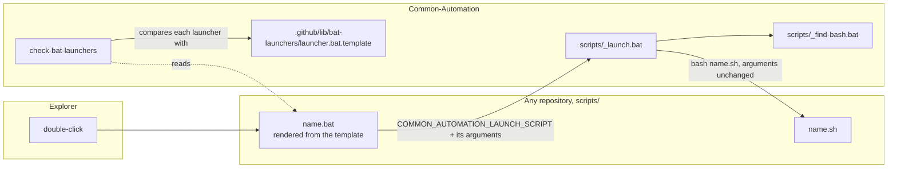

# Shared Batch Launcher

Issue: [#126](https://github.com/Klark-Morrigan/Common-Automation/issues/126)

- [Problem](#problem)
  - [What happened](#what-happened)
  - [Where the copies are](#where-the-copies-are)
  - [What checks a launcher today](#what-checks-a-launcher-today)
  - [What it must be](#what-it-must-be)
- [Solution approach](#solution-approach)
  - [Candidates](#candidates)
  - [Chosen direction](#chosen-direction)
- [Design](#design)
  - [The pieces](#the-pieces)
  - [The launcher](#the-launcher)
  - [The shared body](#the-shared-body)
  - [The template check](#the-template-check)
  - [The Windows suite](#the-windows-suite)
  - [Bats on Windows](#bats-on-windows)
  - [The workflow](#the-workflow)
  - [Runtime](#runtime)
  - [Security](#security)

## Problem

Every `.bat` launcher is a hand-copied body, and nothing runs one before someone double-clicks it,
so a broken launcher reaches the user unnoticed.
One shared body, run by a test on every pull request, would leave one place to get right
and catch the mistake when it is written.

### What happened

Two new launchers, `run-tests-bash.bat` and `run-lint-yaml-and-bash.bat`,
had their `_find-bash.bat` line split with a trailing `\`, bash style.
cmd continues a line with `^`, so each split broke the launcher in its own way:

| Split | What cmd does |
| --- | --- |
| `call ... \|\| \` + `exit /b 1` | The `exit /b 1` line runs on its own, so the launcher exits 1 every time, with no message. |
| `call ... \` + `\|\| exit /b 1` | cmd stops with `\|\| was unexpected at this time.`, exit 255. |

Shellcheck, bats and every other lint passed.
The breakage was found by reading the files and then running scratch copies through cmd by hand.

### Where the copies are

128 launchers across 22 repositories repeat the same seven-line body:
resolve Git Bash, silence the script's own pause, run the `.sh` beside it, hold the window, pass the exit code on.
None of them adds an argument or a setting of its own:
each passes its own arguments on unchanged, and from Explorer there are none.
They differ in two things only:

- the script they run;
- the path to `_find-bash.bat`:
  `%~dp0` in Common-Automation,
  `%~dp0..\..\Common-Automation\scripts\` in a consumer, which expects Common-Automation as a sibling checkout.

| Launcher | Copies |
| --- | --- |
| `setup-hooks.bat` | 22 |
| `fix-permissions.bat`, `run-ci-yaml-and-bash.bat`, `run-lint-yaml-and-bash.bat`, `run-tests-bash.bat` | 21 each |
| `fix-whitespace.bat`, `publish-version-tags.bat` | 6 each |
| `run-ci-gradle.bat` | 4 |
| `show-download-counts.bat` | 3 |
| `run-ci-dotnet.bat` | 2 |
| `show-log-records-sample.bat` | 1 |

KMLib's `run-tests-gradle.bat` and `run-coverage-gradle.bat` are not among them.
They run no `.sh`: each calls `gradlew.bat` with its own fixed task, `test` or `coverage`.

Their comments have already drifted apart in wording.
A fix to the body, such as the line endings `cmd` needs, has to be made in every copy.

### What checks a launcher today

Nothing does.
The lint half checks bash, YAML, workflows and Markdown, and the bats suites run on Linux, where `cmd` does not exist.
`.gitattributes` now pins `*.bat` to CRLF, which settles line endings but not what a launcher does.

### What it must be

- **One body**: the steps every launcher repeats live in one file in Common-Automation.
  A launcher names its script and hands off, in a few fixed lines.
- **Every copy**: all 128 launchers in the 22 repositories move onto the shared body,
  Common-Automation's own and every consumer's.
- **Reached as today**: a consumer's launcher finds the shared body
  the way it finds `_find-bash.bat` now, through the sibling checkout, so no repository gains a new dependency.
- **Behaviour kept**: a launcher still resolves Git Bash, silences the script's own pause,
  passes its arguments through, holds the window, and exits with the script's code.
- **The window is never lost**: every way a launcher can end waits for a key first,
  including Git Bash not found and Common-Automation missing,
  so an error is always there to read.
- **Checked everywhere**: every launcher in every repository is checked against the one template
  on each pull request, and both broken splits above fail that check.
- **Tested by running it**: a suite runs the shared body and a rendered launcher through `cmd` against stubs,
  a PR gate on a Windows runner.
- **Same locally**: the suite also runs on a Windows workstation, through the local CI runners.
- **Cheap**: the suite starts no real script and stays within seconds,
  and the Windows job runs beside the Linux one, so it adds little to a pull request.

## Solution approach

Nothing off the shelf replaces the launchers' body:
it is this repository's own glue between Explorer, Git Bash and the scripts.
The survey looked at what could remove the launchers, and at what could test a batch file.

### Candidates

| Option | Kind | Why not, or why |
| --- | --- | --- |
| Git for Windows `.sh` association | Removes the launchers | Rejected. `git-bash.exe` runs `mintty -- bash --login -i <script>`, and mintty closes when bash exits. A script that fails before it arms its pause trap closes the window with the error unread. The login, interactive shell also runs the user's profile first, and the association is a per-machine setting. |
| [Pester](https://pester.dev) on `windows-latest` | Test harness | Rejected. Common-Automation has no Pester, so it would add a second test language and runner. Borrowing Common-PowerShell's Windows job would make Common-Automation depend on a repository that depends on it. |
| [batest](https://github.com/rbaltrusch/batest) | Test harness | Rejected. A new Python dependency with one maintainer and little use. |
| [batch-unit-test](https://github.com/Radiergummi/batch-unit-test) | Test harness | Rejected. Tests written in batch, with asserts built on `%errorlevel%` and weak reporting. |
| Hand-written `cmd` test script | Test harness | Rejected. It means writing and keeping an assert library. |
| **bats under Git Bash on `windows-latest`** | Test harness | **Chosen.** The repository's one test language, its stand-in pattern and `test-helpers/`, with `cmd` called from Git Bash. |

All are free.
A `windows-latest` minute is free on a public repository and counts double on a private one.

### Chosen direction

Build custom, in three parts:

- **A shared body**, `scripts/_launch.bat`, holding the steps every launcher repeats.
- **One launcher template**, which every launcher in every repository is rendered from,
  and a Linux check that each launcher still matches it.
- **A Windows suite** in Common-Automation alone, run with bats under Git Bash,
  that runs the shared body and a rendered launcher through `cmd`.
- **A `ci-batch.yml` workflow**, named for what it checks as `ci-bash.yml` and `ci-yaml.yml` are,
  holding every batch-file check: the template check, the Windows suite, and later the linter of
  [plan 127](../127-bat-lint/plan.md).
  Every repository calls it, and only a repository with a Windows suite starts a Windows runner.

Only the body behaves; a launcher is fixed text.
So running the body on Windows and checking the text everywhere covers all 128 launchers.

## Design

### The pieces

### The launcher

A launcher is the template with two placeholders filled in:

- `@@SCRIPT@@`, the `.sh` file beside it;
- `@@LAUNCH_BODY@@`, the path to the shared body:
  `%~dp0_launch.bat` in Common-Automation,
  `%~dp0..\..\Common-Automation\scripts\_launch.bat` in a consumer.

Rules the template follows:

- **It names its script in an environment variable**, `COMMON_AUTOMATION_LAUNCH_SCRIPT`, not in an argument.
  cmd's `shift` leaves `%*` unchanged, so a script path passed as `%1` could not be dropped
  from the arguments the body passes on.
  `setlocal` keeps the variable to this run.
- **It checks the body exists before calling it.**
  When Common-Automation is missing, it prints the expected path, waits for a key and exits 1.
  This is the one step the body cannot do for it.
- **Every path inside a parenthesised block is in double quotes.**
  cmd reads a block before expanding it, so an unquoted path holding `)`, as `C:\Program Files (x86)` does,
  ends the block early: cmd stops with `... was unexpected at this time.`, exit 255.
  Inside quotes the `)` is plain text.
  The shared body follows the same rule.
- **It exits with the body's exit code**, so a caller in a terminal sees the script's code.

### The shared body

`scripts/_launch.bat` runs these steps, in order:

| Step | On failure |
| --- | --- |
| Check `COMMON_AUTOMATION_LAUNCH_SCRIPT` is set, so the body was reached from a launcher | Print why, wait, exit 1 |
| `call _find-bash.bat` from its own folder, which sets `%BASH%` | Wait, exit 1. Today's launchers exit here without waiting, so the error closes with the window. |
| Set `COMMON_AUTOMATION_NO_PAUSE=1`, so the script's own exit trap stays quiet | |
| Run `"%BASH%" "%COMMON_AUTOMATION_LAUNCH_SCRIPT%" %*` | |
| Print `Press any key to close ...`, then `pause > nul` | |
| Exit with the script's code | |

The prompt is the body's own text, not `pause`'s.
`pause` prints in the Windows display language;
the body's text matches the bash exit trap's prompt in `_hold-window.sh`,
and a test can look for it on any machine.

### The template check

- **The template** is `.github/lib/bat-launchers/launcher.bat.template`.
  It lives under `.github/lib` because a consumer's CI checks out only `.github/actions` and `.github/lib`
  of Common-Automation.
- **One render function** fills the placeholders.
  The check and the writer both call it, so they cannot disagree.
- **The check** covers every tracked `scripts/*.bat` whose name does not start with `_`
  and that has a `<name>.sh` beside it.
  A `.bat` with no `.sh` beside it, such as KMLib's Gradle launchers, is not a launcher and is left alone.
  It picks the body path by whether the repository tracks `scripts/_launch.bat`:
  only Common-Automation does.
  It compares the file with its rendered template, carriage returns stripped, and names each launcher that differs.
- **The writer**, `scripts/write-bat-launchers.sh`, renders every launcher in a target repository.
  It converts the existing launchers and writes a new one.
- **Where the check runs:** a `check-bat-launchers` action in [`ci-batch.yml`](#the-workflow),
  and the same helper in the lint half locally.
  A repository with no launcher passes with a notice.

### The Windows suite

- **One suite**, `scripts/_launch.windows.bats`.
  The `.windows` part marks a suite that needs `cmd.exe`.
- **Off Windows it skips whole** from `setup_file`, which bats 1.13.0 supports,
  so the Linux runs and the local container run skip it at almost no cost.
- **Each case builds a stand-in tree** in its temp folder, under a folder named `Program Files (x86)`,
  so every case also proves the quoting rule above:
  `Common-Automation/scripts/` with the real `_launch.bat` and a stub `_find-bash.bat`,
  and `Consumer/scripts/` with a rendered launcher and a stub `.sh`.
  The stub `_find-bash.bat` either points `%BASH%` at the Git Bash running the suite or fails.
  The stub `.sh` records its arguments and `COMMON_AUTOMATION_NO_PAUSE`, then exits with a code the case sets.
- **Input comes from `nul`**, so `pause` returns at once.
- **A case asserts** on the exit code, what the stub recorded, and the body's `Press any key to close ...` line.

### Bats on Windows

The Linux `test-bats` action installs bats into `/usr/lib` with `sudo`, and does not run on Windows.
The Windows job installs bats itself:

- `.github/lib/install-bats-core.sh <folder>` clones bats-core at the `BATS_VERSION` tag
  and checks the commit against `BATS_CORE_COMMIT`, a new pin in `.github/lib/versions.env`.
  A tag can be moved; a commit cannot.
- **CI:** the Windows job of [`ci-batch.yml`](#the-workflow) runs it, then the tracked `*.windows.bats`.
- **Locally:** `run-ci-yaml-and-bash.sh` adds a `windows tests` check on a Windows host,
  with bats cached under `${XDG_CACHE_HOME:-${HOME}/.cache}/common-automation/bats-core/<version>`.
  Off Windows, or with no tracked `*.windows.bats`, the check skips.

### The workflow

`ci-batch.yml` follows the shape of the other `ci-*.yml` workflows:
it runs on pull requests and by hand in Common-Automation,
and every consumer calls it through a thin caller of the same name, with `workflow_call`.

| Job | Runner | Does |
| --- | --- | --- |
| `batch` | `ubuntu-latest`, or the `runner` input or `CI_BATCH_RUNNER` variable | Runs the template check, and later the linter. Lists the tracked `*.windows.bats` and outputs whether there are any. |
| `batch-windows` | `windows-latest` | Needs `batch`, and runs only when it found a Windows suite. Installs bats and runs the suites. |

- A consumer has no Windows suite, so its `batch-windows` job is skipped.
  A skipped job passes a required check, so no consumer starts a Windows runner.
- It has no path filter: a required check whose workflow never runs blocks the merge.
- Each consumer gains its caller in the same commit that converts its launchers.

### Runtime

| Run | Cost | Why |
| --- | --- | --- |
| Template check, per repository | under 1 s | Text comparison over a dozen files, no container. |
| `_launch.windows.bats` on Linux | under 1 s | One file loaded; every case skipped. |
| `_launch.windows.bats` on Windows | 15 s budget | Each case starts `cmd`, and in it the Git Bash the stub `.sh` needs; Git Bash process starts are slow. |
| `batch` job | about 15 s | Runner start and checkout dominate; it starts no container. |
| `batch-windows` job, Common-Automation only | about 1 min | Runner start, checkout and the bats clone dominate. It runs beside the bash job, so it adds no wall time while shorter. |

### Security

- The template check only reads files.
- Bats is fetched at a pinned commit, not a tag.
- The Windows suite runs offline, writes only to its temp folder, and starts no real script.
- The body runs the script `COMMON_AUTOMATION_LAUNCH_SCRIPT` names.
  Every launcher sets it just before the call, under `setlocal`, so a value left in the user's environment never reaches the body from a launcher.
