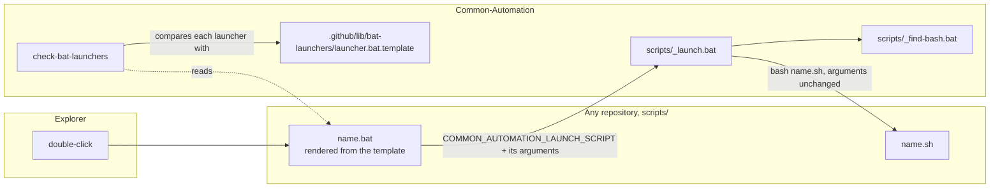
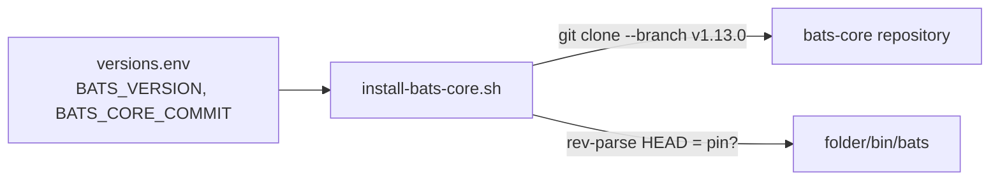
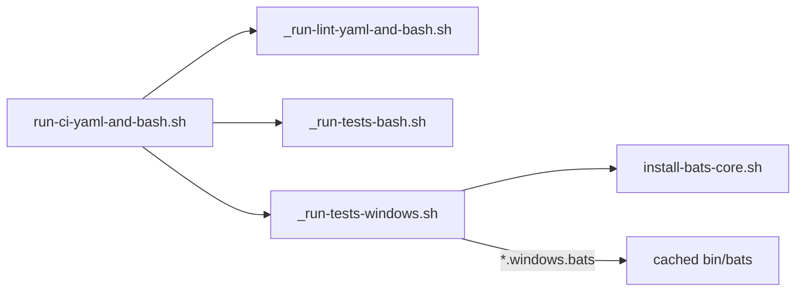
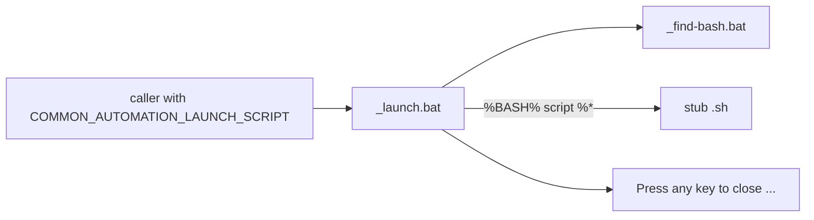
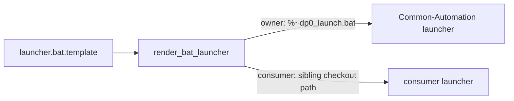
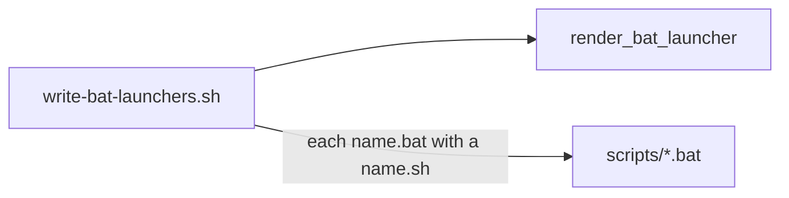
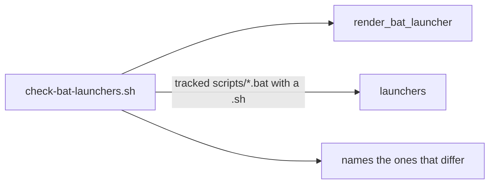
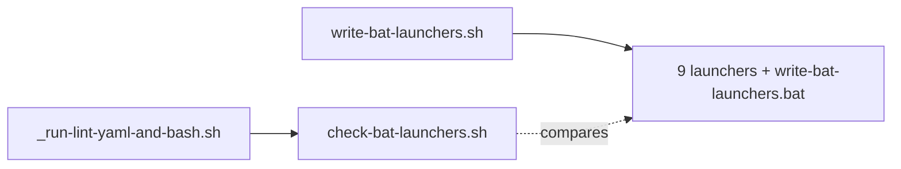
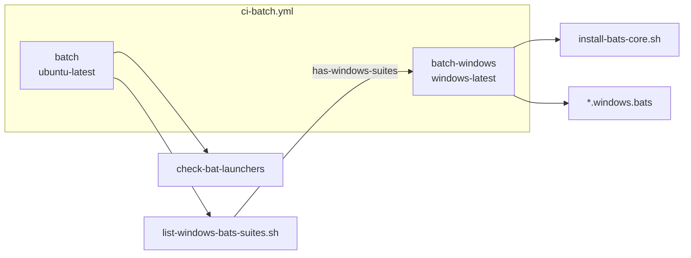
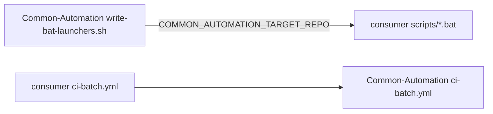

# Shared Batch Launcher

Issue: [#126](https://github.com/Klark-Morrigan/Common-Automation/issues/126)

- [Problem](#problem)
  - [What happened](#what-happened)
  - [Where the copies are](#where-the-copies-are)
  - [What checks a launcher today](#what-checks-a-launcher-today)
  - [What it must be](#what-it-must-be)
- [Solution approach](#solution-approach)
  - [Candidates](#candidates)
  - [Chosen direction](#chosen-direction)
- [Design](#design)
  - [The pieces](#the-pieces)
  - [The launcher](#the-launcher)
  - [The shared body](#the-shared-body)
  - [The template check](#the-template-check)
  - [The Windows suite](#the-windows-suite)
  - [Bats on Windows](#bats-on-windows)
  - [The workflow](#the-workflow)
  - [Runtime](#runtime)
  - [Security](#security)
- [Affected files](#affected-files)
- [Steps](#steps)
  - [1. Bats installs on a Windows host at a pinned commit](#1-bats-installs-on-a-windows-host-at-a-pinned-commit)
  - [2. A local CI run on a Windows host runs the Windows suites](#2-a-local-ci-run-on-a-windows-host-runs-the-windows-suites)
  - [3. The shared launcher body runs a script and always waits for a key before closing](#3-the-shared-launcher-body-runs-a-script-and-always-waits-for-a-key-before-closing)
  - [4. One template renders every launcher](#4-one-template-renders-every-launcher)
  - [5. write-bat-launchers.sh writes a repository's launchers from the template](#5-write-bat-launcherssh-writes-a-repositorys-launchers-from-the-template)
  - [6. check-bat-launchers names each launcher that no longer matches the template](#6-check-bat-launchers-names-each-launcher-that-no-longer-matches-the-template)
  - [7. Common-Automation's launchers run on the shared body, and the lint half checks them](#7-common-automations-launchers-run-on-the-shared-body-and-the-lint-half-checks-them)
  - [8. ci-batch.yml gates pull requests with the template check and the Windows suites](#8-ci-batchyml-gates-pull-requests-with-the-template-check-and-the-windows-suites)
  - [9. Every consumer's launchers run on the shared body, and ci-batch.yml gates its pull requests](#9-every-consumers-launchers-run-on-the-shared-body-and-ci-batchyml-gates-its-pull-requests)

## Problem

Every `.bat` launcher is a hand-copied body, and nothing runs one before someone double-clicks it,
so a broken launcher reaches the user unnoticed.
One shared body, run by a test on every pull request, would leave one place to get right
and catch the mistake when it is written.

### What happened

Two new launchers, `run-tests-bash.bat` and `run-lint-yaml-and-bash.bat`,
had their `_find-bash.bat` line split with a trailing `\`, bash style.
cmd continues a line with `^`, so each split broke the launcher in its own way:

| Split | What cmd does |
| --- | --- |
| `call ... \|\| \` + `exit /b 1` | The `exit /b 1` line runs on its own, so the launcher exits 1 every time, with no message. |
| `call ... \` + `\|\| exit /b 1` | cmd stops with `\|\| was unexpected at this time.`, exit 255. |

Shellcheck, bats and every other lint passed.
The breakage was found by reading the files and then running scratch copies through cmd by hand.

### Where the copies are

128 launchers across 22 repositories repeat the same seven-line body:
resolve Git Bash, silence the script's own pause, run the `.sh` beside it, hold the window, pass the exit code on.
None of them adds an argument or a setting of its own:
each passes its own arguments on unchanged, and from Explorer there are none.
They differ in two things only:

- the script they run;
- the path to `_find-bash.bat`:
  `%~dp0` in Common-Automation,
  `%~dp0..\..\Common-Automation\scripts\` in a consumer, which expects Common-Automation as a sibling checkout.

| Launcher | Copies |
| --- | --- |
| `setup-hooks.bat` | 22 |
| `fix-permissions.bat`, `run-ci-yaml-and-bash.bat`, `run-lint-yaml-and-bash.bat`, `run-tests-bash.bat` | 21 each |
| `fix-whitespace.bat`, `publish-version-tags.bat` | 6 each |
| `run-ci-gradle.bat` | 4 |
| `show-download-counts.bat` | 3 |
| `run-ci-dotnet.bat` | 2 |
| `show-log-records-sample.bat` | 1 |

KMLib's `run-tests-gradle.bat` and `run-coverage-gradle.bat` are not among them.
They run no `.sh`: each calls `gradlew.bat` with its own fixed task, `test` or `coverage`.

Their comments have already drifted apart in wording.
A fix to the body, such as the line endings `cmd` needs, has to be made in every copy.

### What checks a launcher today

Nothing does.
The lint half checks bash, YAML, workflows and Markdown, and the bats suites run on Linux, where `cmd` does not exist.
`.gitattributes` now pins `*.bat` to CRLF, which settles line endings but not what a launcher does.

### What it must be

- **One body**: the steps every launcher repeats live in one file in Common-Automation.
  A launcher names its script and hands off, in a few fixed lines.
- **Every copy**: all 128 launchers in the 22 repositories move onto the shared body,
  Common-Automation's own and every consumer's.
- **Reached as today**: a consumer's launcher finds the shared body
  the way it finds `_find-bash.bat` now, through the sibling checkout, so no repository gains a new dependency.
- **Behaviour kept**: a launcher still resolves Git Bash, silences the script's own pause,
  passes its arguments through, holds the window, and exits with the script's code.
- **The window is never lost**: every way a launcher can end waits for a key first,
  including Git Bash not found and Common-Automation missing,
  so an error is always there to read.
- **Checked everywhere**: every launcher in every repository is checked against the one template
  on each pull request, and both broken splits above fail that check.
- **Tested by running it**: a suite runs the shared body and a rendered launcher through `cmd` against stubs,
  a PR gate on a Windows runner.
- **Same locally**: the suite also runs on a Windows workstation, through the local CI runners.
- **Cheap**: the suite starts no real script and stays within seconds,
  and the Windows job runs beside the Linux one, so it adds little to a pull request.

## Solution approach

Nothing off the shelf replaces the launchers' body:
it is this repository's own glue between Explorer, Git Bash and the scripts.
The survey looked at what could remove the launchers, and at what could test a batch file.

### Candidates

| Option | Kind | Why not, or why |
| --- | --- | --- |
| Git for Windows `.sh` association | Removes the launchers | Rejected. `git-bash.exe` runs `mintty -- bash --login -i <script>`, and mintty closes when bash exits. A script that fails before it arms its pause trap closes the window with the error unread. The login, interactive shell also runs the user's profile first, and the association is a per-machine setting. |
| [Pester](https://pester.dev) on `windows-latest` | Test harness | Rejected. Common-Automation has no Pester, so it would add a second test language and runner. Borrowing Common-PowerShell's Windows job would make Common-Automation depend on a repository that depends on it. |
| [batest](https://github.com/rbaltrusch/batest) | Test harness | Rejected. A new Python dependency with one maintainer and little use. |
| [batch-unit-test](https://github.com/Radiergummi/batch-unit-test) | Test harness | Rejected. Tests written in batch, with asserts built on `%errorlevel%` and weak reporting. |
| Hand-written `cmd` test script | Test harness | Rejected. It means writing and keeping an assert library. |
| **bats under Git Bash on `windows-latest`** | Test harness | **Chosen.** The repository's one test language, its stand-in pattern and `test-helpers/`, with `cmd` called from Git Bash. |

All are free.
A `windows-latest` minute is free on a public repository and counts double on a private one.

### Chosen direction

Build custom, in three parts:

- **A shared body**, `scripts/_launch.bat`, holding the steps every launcher repeats.
- **One launcher template**, which every launcher in every repository is rendered from,
  and a Linux check that each launcher still matches it.
- **A Windows suite** in Common-Automation alone, run with bats under Git Bash,
  that runs the shared body and a rendered launcher through `cmd`.
- **A `ci-batch.yml` workflow**, named for what it checks as `ci-bash.yml` and `ci-yaml.yml` are,
  holding every batch-file check: the template check, the Windows suite, and later the linter of
  [plan 127](../127-bat-lint/plan.md).
  Every repository calls it, and only a repository with a Windows suite starts a Windows runner.

Only the body behaves; a launcher is fixed text.
So running the body on Windows and checking the text everywhere covers all 128 launchers.

## Design

### The pieces

### The launcher

A launcher is the template with two placeholders filled in:

- `@@SCRIPT@@`, the `.sh` file beside it;
- `@@LAUNCH_BODY@@`, the path to the shared body:
  `%~dp0_launch.bat` in Common-Automation,
  `%~dp0..\..\Common-Automation\scripts\_launch.bat` in a consumer.

Rules the template follows:

- **It names its script in an environment variable**, `COMMON_AUTOMATION_LAUNCH_SCRIPT`, not in an argument.
  cmd's `shift` leaves `%*` unchanged, so a script path passed as `%1` could not be dropped
  from the arguments the body passes on.
  `setlocal` keeps the variable to this run.
- **It checks the body exists before calling it.**
  When Common-Automation is missing, it prints the expected path, waits for a key and exits 1.
  This is the one step the body cannot do for it.
- **Every path inside a parenthesised block is in double quotes.**
  cmd reads a block before expanding it, so an unquoted path holding `)`, as `C:\Program Files (x86)` does,
  ends the block early: cmd stops with `... was unexpected at this time.`, exit 255.
  Inside quotes the `)` is plain text.
  The shared body follows the same rule.
- **It exits with the body's exit code**, so a caller in a terminal sees the script's code.

### The shared body

`scripts/_launch.bat` runs these steps, in order:

| Step | On failure |
| --- | --- |
| Check `COMMON_AUTOMATION_LAUNCH_SCRIPT` is set, so the body was reached from a launcher | Print why, wait, exit 1 |
| `call _find-bash.bat` from its own folder, which sets `%BASH%` | Wait, exit 1. Today's launchers exit here without waiting, so the error closes with the window. |
| Set `COMMON_AUTOMATION_NO_PAUSE=1`, so the script's own exit trap stays quiet | |
| Run `"%BASH%" "%COMMON_AUTOMATION_LAUNCH_SCRIPT%" %*` | |
| Print `Press any key to close ...`, then `pause > nul` | |
| Exit with the script's code | |

The prompt is the body's own text, not `pause`'s.
`pause` prints in the Windows display language;
the body's text matches the bash exit trap's prompt in `_hold-window.sh`,
and a test can look for it on any machine.

### The template check

- **The template** is `.github/lib/bat-launchers/launcher.bat.template`.
  It lives under `.github/lib` because a consumer's CI checks out only `.github/actions` and `.github/lib`
  of Common-Automation.
- **One render function** fills the placeholders.
  The check and the writer both call it, so they cannot disagree.
- **The check** covers every tracked `scripts/*.bat` whose name does not start with `_`
  and that has a `<name>.sh` beside it.
  A `.bat` with no `.sh` beside it, such as KMLib's Gradle launchers, is not a launcher and is left alone.
  It picks the body path by whether the repository tracks `scripts/_launch.bat`:
  only Common-Automation does.
  It compares the file with its rendered template, carriage returns stripped, and names each launcher that differs.
- **The writer**, `scripts/write-bat-launchers.sh`, renders every launcher in a target repository.
  It converts the existing launchers and writes a new one.
- **Where the check runs:** a `check-bat-launchers` action in [`ci-batch.yml`](#the-workflow),
  and the same helper in the lint half locally.
  A repository with no launcher passes with a notice.

### The Windows suite

- **One suite**, `scripts/_launch.windows.bats`.
  The `.windows` part marks a suite that needs `cmd.exe`.
- **Off Windows it skips whole** from `setup_file`, which bats 1.13.0 supports,
  so the Linux runs and the local container run skip it at almost no cost.
- **Each case builds a stand-in tree** in its temp folder, under a folder named `Program Files (x86)`,
  so every case also proves the quoting rule above:
  `Common-Automation/scripts/` with the real `_launch.bat` and a stub `_find-bash.bat`,
  and `Consumer/scripts/` with a rendered launcher and a stub `.sh`.
  The stub `_find-bash.bat` either points `%BASH%` at the Git Bash running the suite or fails.
  The stub `.sh` records its arguments and `COMMON_AUTOMATION_NO_PAUSE`, then exits with a code the case sets.
- **Input comes from `nul`**, so `pause` returns at once.
- **A case asserts** on the exit code, what the stub recorded, and the body's `Press any key to close ...` line.

### Bats on Windows

The Linux `test-bats` action installs bats into `/usr/lib` with `sudo`, and does not run on Windows.
The Windows job installs bats itself:

- `.github/lib/install-bats-core.sh <folder>` clones bats-core at the `BATS_VERSION` tag
  and checks the commit against `BATS_CORE_COMMIT`, a new pin in `.github/lib/versions.env`.
  A tag can be moved; a commit cannot.
- **CI:** the Windows job of [`ci-batch.yml`](#the-workflow) runs it, then the tracked `*.windows.bats`.
- **Locally:** `run-ci-yaml-and-bash.sh` adds a `windows tests` check on a Windows host,
  with bats cached under `${XDG_CACHE_HOME:-${HOME}/.cache}/common-automation/bats-core/<version>`.
  Off Windows, or with no tracked `*.windows.bats`, the check skips.

### The workflow

`ci-batch.yml` follows the shape of the other `ci-*.yml` workflows:
it runs on pull requests and by hand in Common-Automation,
and every consumer calls it through a thin caller of the same name, with `workflow_call`.

| Job | Runner | Does |
| --- | --- | --- |
| `batch` | `ubuntu-latest`, or the `runner` input or `CI_BATCH_RUNNER` variable | Runs the template check, and later the linter. Lists the tracked `*.windows.bats` and outputs whether there are any. |
| `batch-windows` | `windows-latest` | Needs `batch`, and runs only when it found a Windows suite. Installs bats and runs the suites. |

- A consumer has no Windows suite, so its `batch-windows` job is skipped.
  A skipped job passes a required check, so no consumer starts a Windows runner.
- It has no path filter: a required check whose workflow never runs blocks the merge.
- Each consumer gains its caller in the same commit that converts its launchers.

### Runtime

| Run | Cost | Why |
| --- | --- | --- |
| Template check, per repository | under 1 s | Text comparison over a dozen files, no container. |
| `_launch.windows.bats` on Linux | under 1 s | One file loaded; every case skipped. |
| `_launch.windows.bats` on Windows | 15 s budget | Each case starts `cmd`, and in it the Git Bash the stub `.sh` needs; Git Bash process starts are slow. |
| `batch` job | about 15 s | Runner start and checkout dominate; it starts no container. |
| `batch-windows` job, Common-Automation only | about 1 min | Runner start, checkout and the bats clone dominate. It runs beside the bash job, so it adds no wall time while shorter. |

### Security

- The template check only reads files.
- Bats is fetched at a pinned commit, not a tag.
- The Windows suite runs offline, writes only to its temp folder, and starts no real script.
- The body runs the script `COMMON_AUTOMATION_LAUNCH_SCRIPT` names.
  Every launcher sets it just before the call, under `setlocal`, so a value left in the user's environment never reaches the body from a launcher.

## Affected files

| File | Change | Step |
| --- | --- | --- |
| [.github/lib/versions.env](../../../../.github/lib/versions.env) | Adds `BATS_CORE_COMMIT` beside `BATS_VERSION` | [1](#1-bats-installs-on-a-windows-host-at-a-pinned-commit) |
| [scripts/run-ci-yaml-and-bash.sh](../../../../scripts/run-ci-yaml-and-bash.sh) and its `.bats` | Runs the Windows half as a third check | [2](#2-a-local-ci-run-on-a-windows-host-runs-the-windows-suites) |
| [scripts/_run-lint-yaml-and-bash.sh](../../../../scripts/_run-lint-yaml-and-bash.sh) and its `.bats` | Runs `check-bat-launchers` | [7](#7-common-automations-launchers-run-on-the-shared-body-and-the-lint-half-checks-them) |
| `scripts/*.bat`, the 9 launchers | Rewritten from the template | [7](#7-common-automations-launchers-run-on-the-shared-body-and-the-lint-half-checks-them) |
| [README.md](../../../../README.md) | Each step updates the sections its change makes untrue | every step |
| In each of the 21 consumer repositories: `scripts/*.bat` | Rewritten from the template | [9](#9-every-consumers-launchers-run-on-the-shared-body-and-ci-batchyml-gates-its-pull-requests) |

New files:

- `.github/lib/install-bats-core.sh`, `.github/lib/install-bats-core.bats`
- `scripts/_run-tests-windows.sh`, `scripts/_run-tests-windows.bats`
- `scripts/_launch.bat`, `scripts/_launch.windows.bats`
- `.github/lib/bat-launchers/launcher.bat.template`
- `.github/lib/bat-launchers/render-bat-launcher.sh`, `.github/lib/bat-launchers/render-bat-launcher.bats`
- `scripts/write-bat-launchers.sh`, `scripts/write-bat-launchers.bats`, and `scripts/write-bat-launchers.bat`,
  which the writer renders for itself
- `.github/actions/check-bat-launchers/action.yml`, `check-bat-launchers.sh`, `check-bat-launchers.bats`
- `.github/lib/list-windows-bats-suites.sh`, `.github/lib/list-windows-bats-suites.bats`
- `.github/workflows/ci-batch.yml`
- In each of the 21 consumer repositories: `.github/workflows/ci-batch.yml`, the thin caller

## Steps

Every step carries its own tests and its README update, and is not done without them.
Each step is one commit.
The suites a step names run in the step, and their wall time is reported beside the pass count.

### 1. Bats installs on a Windows host at a pinned commit

**Problem.**
The Linux `test-bats` action cannot run on Windows,
and the bats on a Windows workstation is whatever version was installed by hand.
The Windows suites need the version CI pins, fetched the same way everywhere
([Bats on Windows](#bats-on-windows)).

**Solution.**
`.github/lib/install-bats-core.sh <folder>` clones bats-core at the `v${BATS_VERSION}` tag into the folder
and fails unless the checked-out commit is `BATS_CORE_COMMIT`.
A folder already holding that commit is reused without a clone.
The repository URL defaults to bats-core's on GitHub and can be pointed elsewhere by `BATS_CORE_REPOSITORY_URL`,
which the suite uses for an offline fixture.
`versions.env` gains `BATS_CORE_COMMIT`.

**Verification** (`install-bats-core.bats`, new, 15 s budget: each case runs real git over a local fixture repository).

- Given a local bare repository with a `v1.13.0` tag on the pinned commit,
  when the installer runs into an empty folder,
  then `<folder>/bin/bats` exists and the folder's `HEAD` is the pinned commit.
  Integration.

**Test cases** (`install-bats-core.bats`).

- Given the tag points at a different commit, when the installer runs, then it exits 1 naming both commits and leaves no `bin/bats`. Integration.
- Given the folder already holds the pinned commit, when the installer runs, then it clones nothing. Integration.
- Given `BATS_CORE_COMMIT` is missing from the pins, when the installer runs, then it exits 1 naming the missing pin.

### 2. A local CI run on a Windows host runs the Windows suites

**Problem.**
The Windows suites must also run on the user's workstation, through the same runners as every other check.
The test half runs bats in a Linux container, where `cmd.exe` does not exist.

**Solution.**
`scripts/_run-tests-windows.sh` is a third half beside the lint and test halves.
On a host with `cmd.exe` and tracked `*.windows.bats`,
it installs bats through [step 1](#1-bats-installs-on-a-windows-host-at-a-pinned-commit)'s installer
into `${XDG_CACHE_HOME:-${HOME}/.cache}/common-automation/bats-core/<version>`, then runs those suites.
Off Windows, or with no such suite, it skips with a notice.
`run-ci-yaml-and-bash.sh` runs it as a third recorded check, `windows tests`.

**Verification** (`run-ci-yaml-and-bash.bats`, existing, +2 s: one more stub half run in the case).

- Given stub halves that pass, when the orchestrator runs, then it prints the `lint`, `bash tests` and `windows tests` headings in that order and passes.

**Test cases** (`_run-tests-windows.bats`, new, 15 s budget: each case starts the runner with stubbed tools).

- Given no `cmd.exe` on PATH, when the half runs, then it skips with a notice and installs nothing.
- Given `cmd.exe` on PATH and no tracked `*.windows.bats`, when the half runs, then it skips with a notice and installs nothing.
- Given `cmd.exe` and a tracked `a.windows.bats`, when the half runs, then it installs into the cache folder for the pinned version and runs bats over `a.windows.bats` alone.
- Given the stub bats fails, when the half runs, then it ends `FAILED (windows tests)`.

Added to `run-ci-yaml-and-bash.bats` (+2 s each, one orchestrator run with stub halves):

- Given the Windows half fails, when the orchestrator runs, then it still finishes and names `windows tests` among the failures.

### 3. The shared launcher body runs a script and always waits for a key before closing

**Problem.**
Every launcher repeats the same body, and today's copies exit without waiting when Git Bash is not found
([What it must be](#what-it-must-be)).

**Solution.**
`scripts/_launch.bat` implements [The shared body](#the-shared-body).
`scripts/_launch.windows.bats` builds the stand-in tree of [The Windows suite](#the-windows-suite)
and skips whole off Windows.

**Verification** (`_launch.windows.bats`, new, 15 s budget: each case starts `cmd`, and most start Git Bash for the stub).

- Given a stand-in whose `_find-bash.bat` fails, when the body runs with input from `nul`,
  then it prints `Press any key to close ...` and exits 1, running no script.
  Integration.

**Test cases** (`_launch.windows.bats`).

- Given arguments `one` and `two words`, when the body runs, then the stub script records exactly those two arguments. Integration.
- Given the stub script exits 3, when the body runs, then the body exits 3. Integration.
- Given a run, when the stub script reads `COMMON_AUTOMATION_NO_PAUSE`, then it is `1`. Integration.
- Given the stub script prints a line, when the body runs, then `Press any key to close ...` comes after that line. Integration.
- Given `COMMON_AUTOMATION_LAUNCH_SCRIPT` is unset, when the body runs, then it says it must be started from a launcher, prints the prompt and exits 1. Integration.
- Given a Linux host, when the suite runs, then every case is skipped. Run by the container test half.

### 4. One template renders every launcher

**Problem.**
The launchers must be one fixed text, so that a check can compare them and a fix reaches every copy
([The launcher](#the-launcher)).

**Solution.**
`.github/lib/bat-launchers/launcher.bat.template` holds the launcher of [The launcher](#the-launcher),
with `@@SCRIPT@@` and `@@LAUNCH_BODY@@`.
`.github/lib/bat-launchers/render-bat-launcher.sh` defines `render_bat_launcher <script> <owner|consumer>`,
which prints the filled template with CRLF line endings.

**Verification** (`render-bat-launcher.bats`, new, 15 s budget: each case starts the render function in a bats process).

- Given `run-tests-bash.sh` and `consumer`, when rendered,
  then the output equals a literal launcher text with `%~dp0..\..\Common-Automation\scripts\_launch.bat`, every line ending in CRLF.

**Test cases** (`render-bat-launcher.bats`).

- Given `owner`, when rendered, then the body path is `%~dp0_launch.bat`.
- Given a layout other than `owner` or `consumer`, when rendered, then it exits 1 naming the allowed layouts.

Added to `_launch.windows.bats` (+2 s each: one `cmd` and one Git Bash start):

- Given a rendered consumer launcher beside a real body, when the launcher runs with an argument, then the stub script records it and the launcher exits with the script's code. Integration.
- Given a rendered consumer launcher with no body at the sibling path, when it runs, then it prints the expected body path and the prompt, and exits 1. Integration.

### 5. write-bat-launchers.sh writes a repository's launchers from the template

**Problem.**
128 launchers are converted by hand, and a new one is copied from an old one.
Both are how the copies drifted.

**Solution.**
`scripts/write-bat-launchers.sh` renders, for the target repository,
every `scripts/<name>.bat` that has a `scripts/<name>.sh` beside it,
plus a launcher for each script name given as an argument.
It picks `owner` when the repository tracks `scripts/_launch.bat`, else `consumer`.
It targets a repository the way the other runners do, through `COMMON_AUTOMATION_TARGET_REPO`.

**Verification** (`write-bat-launchers.bats`, new, 15 s budget: each case builds a fixture git repository).

- Given a fixture repository with `scripts/a.sh` and an old-style `scripts/a.bat`,
  when the writer runs against it, then `a.bat` equals the rendered consumer launcher for `a.sh`.
  Integration.

**Test cases** (`write-bat-launchers.bats`).

- Given `scripts/b.bat` with no `b.sh`, when the writer runs, then `b.bat` is unchanged. Integration.
- Given `scripts/_x.bat` beside `_x.sh`, when the writer runs, then `_x.bat` is unchanged. Integration.
- Given the argument `c` and a `scripts/c.sh` with no launcher, when the writer runs, then it writes `c.bat`. Integration.
- Given the argument `d` and no `scripts/d.sh`, when the writer runs, then it exits 1 naming `d.sh` and writes nothing. Integration.
- Given the repository tracks `scripts/_launch.bat`, when the writer runs, then it writes owner launchers. Integration.

### 6. check-bat-launchers names each launcher that no longer matches the template

**Problem.**
Both broken splits passed every check ([What happened](#what-happened)).
A launcher that drifts from the template must fail before it merges ([The template check](#the-template-check)).

**Solution.**
`.github/actions/check-bat-launchers/check-bat-launchers.sh` compares each tracked launcher with its rendered template,
carriage returns stripped, names each one that differs, and exits 1 if any does.
`action.yml` wraps it as a composite action.

**Verification** (`check-bat-launchers.bats`, new, 15 s budget: each case builds a fixture git repository).

- Given a fixture repository whose `a.bat` has the `_find-bash.bat` line split with a trailing `\`,
  when the check runs, then it exits 1 and names `scripts/a.bat`.
  Integration.

**Test cases** (`check-bat-launchers.bats`).

- Given every launcher matches, when the check runs, then it passes. Integration.
- Given a matching launcher checked out with LF line endings, when the check runs, then it passes. Integration.
- Given an untracked `scripts/b.bat` that differs, when the check runs, then it passes. Integration.
- Given a `scripts/c.bat` with no `c.sh`, when the check runs, then it passes. Integration.
- Given no launcher at all, when the check runs, then it passes with a notice. Integration.
- Given the repository tracks `scripts/_launch.bat` and a launcher in the consumer form, when the check runs, then it names that launcher. Integration.

### 7. Common-Automation's launchers run on the shared body, and the lint half checks them

**Problem.**
Common-Automation's 9 launchers still carry the old body,
and nothing runs the template check locally.

**Solution.**
`write-bat-launchers.sh` rewrites the 9 launchers and writes `write-bat-launchers.bat` for itself.
`_run-lint-yaml-and-bash.sh` runs `check-bat-launchers` as a recorded check.

**Verification** (`_run-lint-yaml-and-bash.bats`, existing, +2 s: one more stub helper in the run).

- Given stub helpers that pass, when the lint half runs, then it prints a `check-bat-launchers` heading and passes.

**Test cases.**
The verification is the step's one new case;
the rewritten launchers are covered by `check-bat-launchers` itself on every lint run.

### 8. ci-batch.yml gates pull requests with the template check and the Windows suites

**Problem.**
The checks must be PR gates, and a repository with no Windows suite must not start a Windows runner
([The workflow](#the-workflow)).

**Solution.**
`.github/workflows/ci-batch.yml` has the `batch` and `batch-windows` jobs of [The workflow](#the-workflow).
`.github/lib/list-windows-bats-suites.sh` prints the tracked `*.windows.bats`, one per line,
and `batch` turns that into the `has-windows-suites` output.
`batch-windows` runs the installer of [step 1](#1-bats-installs-on-a-windows-host-at-a-pinned-commit)
and then the listed suites.

**Verification** (`list-windows-bats-suites.bats`, new, 15 s budget: each case builds a fixture git repository).

- Given a fixture repository tracking `a.windows.bats` and `b.bats`, when listed, then the output is `a.windows.bats` alone.
  Integration.

**Test cases** (`list-windows-bats-suites.bats`).

- Given no tracked `*.windows.bats`, when listed, then the output is empty. Integration.
- Given an untracked `c.windows.bats`, when listed, then it is not in the output. Integration.

The workflow itself is checked by `actionlint` and `action-validator` in the lint half.

### 9. Every consumer's launchers run on the shared body, and ci-batch.yml gates its pull requests

**Problem.**
The 21 consumer repositories still carry 119 launchers with the old body, and none runs the template check.

**Solution.**
One commit per repository, in that repository, in the order below.
Each runs `write-bat-launchers.sh` against itself, which rewrites its launchers,
and adds a thin `.github/workflows/ci-batch.yml` caller in the shape of its `ci-bash.yml` caller.
KMLib's `run-tests-gradle.bat` and `run-coverage-gradle.bat` stay as they are, since no `.sh` sits beside them.

| Sub-step | Repository |
| --- | --- |
| 9.1 | Common-Ansible |
| 9.2 | Common-DotNet |
| 9.3 | Common-Java |
| 9.4 | Common-JavaScript |
| 9.5 | Common-PowerShell |
| 9.6 | Infrastructure-E2E |
| 9.7 | Infrastructure-GitHub |
| 9.8 | Infrastructure-GitHubRunners |
| 9.9 | Infrastructure-HyperV |
| 9.10 | Infrastructure-Network-Windows |
| 9.11 | Infrastructure-Secrets |
| 9.12 | Infrastructure-Vm-Provisioner |
| 9.13 | Infrastructure-Vm-Users |
| 9.14 | Infrastructure-Wsl |
| 9.15 | Noita-KModManager |
| 9.16 | Starsector-Mod-KMLib |
| 9.17 | Starsector-Mod-KMO |
| 9.18 | Starsector-Mod-KMP |
| 9.19 | Starsector-Mod-KMU |
| 9.20 | SynergyOps.Suite |
| 9.21 | SynergyOps.TaskManager |

**Verification** (each repository's own lint half, through its `run-lint-yaml-and-bash.sh`).

- Given the rewritten launchers, when the repository's lint half runs, then `check-bat-launchers` passes.

**Test cases.**
None new: the repositories gain no code of their own, only launchers the check covers.
