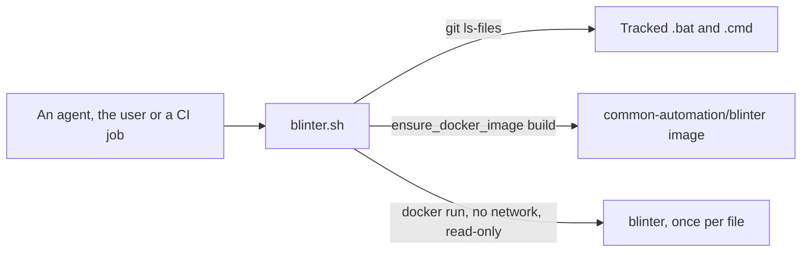
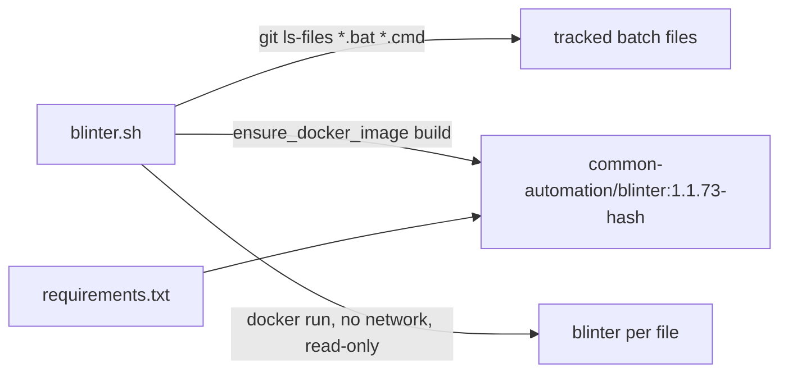
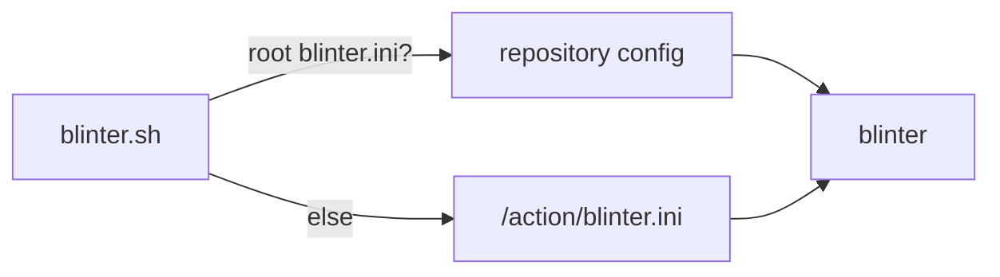
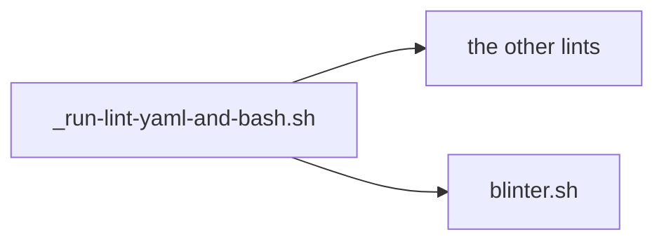
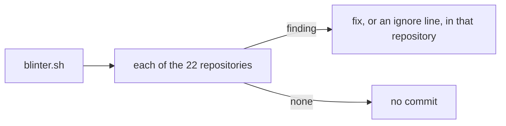
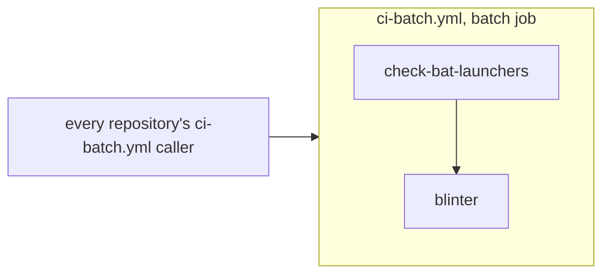
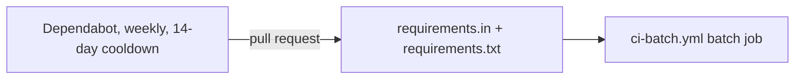

# Batch File Lint

Issue: [#127](https://github.com/Klark-Morrigan/Common-Automation/issues/127)

- [Problem](#problem)
  - [What a reader misses](#what-a-reader-misses)
  - [The trial](#the-trial)
  - [What it must be](#what-it-must-be)
- [Solution approach](#solution-approach)
  - [Candidates](#candidates)
  - [The design trial](#the-design-trial)
- [Design](#design)
  - [The run](#the-run)
  - [The config](#the-config)
  - [The image](#the-image)
  - [Where it runs](#where-it-runs)
  - [Runtime](#runtime)
  - [Security](#security)
- [Affected files](#affected-files)
- [Steps](#steps)
  - [1. blinter.sh lints a repository's tracked batch files in a pinned, offline container](#1-blintersh-lints-a-repositorys-tracked-batch-files-in-a-pinned-offline-container)
  - [2. The bundled config passes the shared launcher and body, and a repository's own config wins](#2-the-bundled-config-passes-the-shared-launcher-and-body-and-a-repositorys-own-config-wins)
  - [3. The lint half runs Blinter](#3-the-lint-half-runs-blinter)
  - [4. Every repository's batch files pass Blinter before it gates them](#4-every-repositorys-batch-files-pass-blinter-before-it-gates-them)
  - [5. ci-batch.yml lints every repository's batch files](#5-ci-batchyml-lints-every-repositorys-batch-files)
  - [6. Dependabot keeps the Blinter pins current, two weeks behind a release](#6-dependabot-keeps-the-blinter-pins-current-two-weeks-behind-a-release)

## Problem

Nothing reads a batch file for the mistakes cmd trips on,
so LF-only line endings or code after an unconditional `exit` are found only when a launcher fails.
A pinned batch linter in the lint half would flag them on every pull request, beside shellcheck.

### What a reader misses

The launchers are short, and their failures are not visible in the text:

- A file with LF line endings looks the same as one with CRLF,
  but cmd can misread labels and `goto` targets in it.
  Six of Common-Automation's nine `.bat` files had LF working copies.
- A line split with `\` reads like a bash continuation,
  but cmd runs the next line on its own, so an `exit` meant for the failure path always runs.

The [shared launcher plan](../126-shared-bat-launcher/plan.md) catches what a launcher does by running it.
A linter is the cheaper check that needs no Windows runner, and it covers any batch file, not only the launchers.

### The trial

Blinter 1.1.73, run in a throwaway `python:3.12-slim` container:

| Case | Result |
| --- | --- |
| `call ... \|\| \` + `exit /b 1`, which always exits 1 | Caught as E008: the code after the `exit` can never run. It does not name the split itself. |
| `call ... \` + `\|\| exit /b 1`, a syntax error | Missed. |
| `call ... ^` + `\|\| exit /b 1`, correct | Clean. |
| LF-only line endings | Caught as E018, on all seven LF files. |

On Common-Automation's own `scripts/` it reported 54 findings, most of them noise for a launcher:

- S007, use `.cmd` over `.bat`, on every file;
- W028, `%errorlevel%` differs between `.bat` and `.cmd`;
- SEC014, `%*` passed on unescaped, which is the launcher's job;
- P003, `SETLOCAL` without a `SET`.

Release 1.1.73 is licensed AGPL-3.0-or-later.
The project releases often: 1.0.2 to 1.1.73 in the PyPI history.

### What it must be

- **Pinned**: one exact version of Blinter and of everything it installs, each checked against its hash,
  and named from `.github/lib/versions.env` where the other tool pins live.
- **Contained**: it runs in a container with no network, as the other dockerised linters do,
  so the package never runs on the host.
- **Quiet**: a shared config turns off the rules that do not fit a launcher,
  so a finding means something to fix.
- **Same everywhere**: one helper runs it for an agent, for the user and in CI, from the lint half.
- **Skips cleanly**: a repository with no batch files passes without starting the container.
- **Cheap**: a run over a repository's batch files stays within a few seconds once the image is built.

## Solution approach

Adopt Blinter, pinned with hashes, in an offline container, with a bundled config.
It is the only maintained batch linter that runs on Linux,
so it runs in the same Linux job as the other lints and needs no Windows runner.

### Candidates

| Option | Source, licence, upkeep | Fit | Verdict |
| --- | --- | --- | --- |
| [Blinter](https://pypi.org/project/Blinter/) | Open source, AGPL-3.0-or-later. Effectively one maintainer; the repository moved from `tboy1337` to the `BatchLang` organisation. Very frequent releases. | Catches LF endings and dead code after an `exit`, and has config and inline ignores. Misses the syntax error of [the trial](#the-trial). | **Adopted.** |
| [BatCodeCheck](https://www.robvanderwoude.com/battech_batcodecheck.php) | Closed source, freeware, a Windows `.exe`, not updated in years | Classic batch checks | Rejected: needs a Windows runner, and its code cannot be read. |
| A custom check, such as a grep for a trailing `\` | Ours | The failures already seen, and nothing else | Rejected: [plan 126](../126-shared-bat-launcher/plan.md)'s template check already catches the launchers' drift. |

All are free.

### The design trial

Blinter 1.1.73 in `python:3.12-alpine`, run over the launcher and the shared body as plan 126 designs them:

| Rule | Where | What it is | Handled by |
| --- | --- | --- | --- |
| E045, `pause` takes no arguments | `pause > nul`, 4 times | A false positive: the space before `nul` reads as an argument. `pause >nul` passes. | Plan 126 writes `pause >nul`. |
| E006, undefined variable | `%BASH%` in the body | `_find-bash.bat` sets it, and `--follow-calls` does not see that | An inline ignore in the body |
| W033, ambiguous `call` | `call "%launch_body%"` | The path is a variable holding `.bat` | An inline ignore in the template |
| SEC014, unescaped input | `%*`, in both | Passing the arguments on is the launcher's job | An inline ignore in both |
| W028, `.bat` and `.cmd` differ | every `set` | Holds only for a choice between `.bat` and `.cmd`, and the launchers stay `.bat` | Disabled |
| S007, use `.cmd` | every file | The same choice | Disabled |
| S008, missing comments | the template's `if` block | Asks for a comment on what code does; comments here say why | Disabled |
| S020, long line | the template's `rem` line | A real finding at the default 100 columns | Kept, at 120 columns, the repository's cap |

The inline ignores sit in plan 126's template and body, which are written to pass:
its [launcher](../126-shared-bat-launcher/plan.md#the-launcher) and
[body](../126-shared-bat-launcher/plan.md#the-shared-body) carry them,
so this plan never renders the launchers again.

## Design

### The run



`.github/actions/blinter/blinter.sh` is the one entry point, as `yamllint.sh` is for yamllint.

- It lists `git ls-files -- '*.bat' '*.cmd'` in the current directory; outside a work tree it is an error.
- A tracked file missing from the work tree is skipped.
- A file named `gradlew.bat` is left out: Gradle generates it, and KMLib, KMO and KMU track one.
- No tracked batch file is a `::notice::` and exit 0, with no image built and no container started.
- One container runs Blinter once per file, since its command line takes one path,
  and exits 1 when any run found something.
- Each run passes `--fail-on style`, so every finding the config leaves on fails.

### The config

`.github/actions/blinter/blinter.ini`, mounted read-only at `/action`:

```ini
[general]
max_line_length = 120

[rules]
disabled_rules = S007, W028, S008
```

A `blinter.ini` at the repository's root wins, as a consumer's `.yamllint` does for yamllint,
so a repository can tighten or relax the bar.
A rule is disabled only when it never fits a batch file of these repositories;
a rule that misfires on one line takes a `REM LINT:IGNORE <code>` line above it,
so it still runs everywhere else.

### The image

`common-automation/blinter:<tag>`, built from a Dockerfile in the action folder through `ensure_docker_image … build`.

- **Base**: `python:3.12-alpine`, yamllint's base, so the two images share their base layers.
- **Packages**: `requirements.in` pins `Blinter==1.1.73`.
  `requirements.txt` is compiled from it with `pip-compile --generate-hashes`,
  pinning Blinter and `charset-normalizer`, its one dependency,
  with the hash of every wheel each release ships.
  `charset-normalizer` ships a wheel per platform, so one hash alone would fail on another machine.
- **Install**: `pip install --no-cache-dir --require-hashes --only-binary :all: -r requirements.txt`.
  Wheels only, so no package's build script runs; a hash mismatch fails the build.
- **Tag**: `<Blinter version>-<hash>`,
  the hash being the first 12 hex digits of a SHA-256 over the Dockerfile and `requirements.txt`,
  so a change to either builds anew and an unchanged image costs one `docker image inspect`.
- **Bumps**: Dependabot's `pip` ecosystem, one entry for `/.github/actions/blinter`, weekly,
  with `cooldown: default-days: 14`, so a pin is a release at least two weeks old.
  Its pull request runs the gate against the new image.
- **Where the pin lives**: `requirements.txt`, not `versions.env`, which cannot hold a hash per wheel.
  `versions.env`'s header names it,
  and the action's README holds the compile command for a bump by hand.

### Where it runs

- **CI:** a `blinter` step in the `batch` job of plan 126's
  [`ci-batch.yml`](../126-shared-bat-launcher/plan.md#the-workflow), after the template check.
  This plan's steps follow plan 126's, since they need that workflow.
- **Locally:** a `blinter` check in the lint half, `_run-lint-yaml-and-bash.sh`.

### Runtime

| Run | Cost | Why |
| --- | --- | --- |
| First build | about 20 s, once per pin | Two wheels from PyPI. |
| A run with the image cached | 1 to 2 s | One container start; each file lints in milliseconds. |
| A repository with no batch file | under 1 s | `git ls-files` only. |

### Security

- The repository and the action folder are mounted read-only,
  and the container runs with `--read-only` and `--network none`,
  so a compromised package can neither change the checkout nor send anything out.
- Every wheel is checked against its hash, and no source build runs.
- The 14-day cooldown and a reviewed pull request stand between a new release and the gate.
  That matters here: one maintainer, frequent releases, and a repository that changed owner.
- AGPL-3.0: the image runs Blinter unmodified and is built where it runs, never published,
  so it distributes nothing that would oblige a source offer.

## Affected files

| File | Change | Step |
| --- | --- | --- |
| [.github/lib/versions.env](../../../../.github/lib/versions.env) | Its header names `requirements.txt` as the home of the Blinter pins | [1](#1-blintersh-lints-a-repositorys-tracked-batch-files-in-a-pinned-offline-container) |
| [scripts/_run-lint-yaml-and-bash.sh](../../../../scripts/_run-lint-yaml-and-bash.sh) and its `.bats` | Runs `blinter.sh` | [3](#3-the-lint-half-runs-blinter) |
| `.github/workflows/ci-batch.yml`, from plan 126 | Its `batch` job runs the `blinter` action | [5](#5-ci-batchyml-lints-every-repositorys-batch-files) |
| [README.md](../../../../README.md) | Each step updates the sections its change makes untrue | every step |
| Any batch file Blinter reports, in any of the 22 repositories | Fixed, or given an ignore line | [4](#4-every-repositorys-batch-files-pass-blinter-before-it-gates-them) |

New files, all in `.github/actions/blinter/` unless named otherwise:

- `Dockerfile`, `requirements.in`, `requirements.txt`
- `blinter.sh`, `blinter.bats`, `action.yml`, `README.md`
- `blinter.ini`
- `.github/dependabot.yml`, or its `pip` entry when another plan created the file first

## Steps

Every step carries its own tests and its README update, and is not done without them.
Each step is one commit.
The suites a step names run in the step, and their wall time is reported beside the pass count.
The steps run after [plan 126](../126-shared-bat-launcher/plan.md)'s:
step 2 lints its launcher and body, and step 5 extends its workflow.

### 1. blinter.sh lints a repository's tracked batch files in a pinned, offline container

**Problem.**
Nothing reads a batch file for the mistakes cmd trips on ([Problem](#problem)).

**Solution.**
`.github/actions/blinter/` holds the image of [The image](#the-image) and the runner of [The run](#the-run):
the `Dockerfile`, `requirements.in` and its hash-pinned `requirements.txt`,
`blinter.sh`, and `action.yml` wrapping it as a composite action.
The runner lints with Blinter's defaults until [step 2](#2-the-bundled-config-passes-the-shared-launcher-and-body-and-a-repositorys-own-config-wins) adds the config.
`versions.env`'s header names `requirements.txt`.



**Verification** (`blinter.bats`, new, 15 s budget with the image cached: the docker cases start one container each, the rest only `git`; the first run builds the image once, about 20 s).

- Given a fixture repository tracking an LF-only `a.bat`, when the runner runs, then it exits 1 and the output names E018.
  Integration, skipped without Docker.

**Test cases** (`blinter.bats`).

- Given no tracked `.bat` or `.cmd`, when the runner runs, then it passes with a notice and the docker stub is never called.
- Given an untracked `b.bat`, when the runner runs, then `b.bat` is not linted.
- Given a tracked `gradlew.bat`, when the runner runs, then it is not linted.
- Given a tracked file deleted from the work tree, when the runner runs, then it is skipped.
- Given a tracked `c.cmd`, when the runner runs, then it is linted.
- Given a run, when the docker stub records its arguments, then they hold `--network none`, `--read-only` and read-only mounts.
- Given an edit to `requirements.txt`, when the tag is worked out, then it differs from the tag before.
- Given a clean CRLF `d.bat`, when the runner runs, then it passes. Integration, skipped without Docker.

### 2. The bundled config passes the shared launcher and body, and a repository's own config wins

**Problem.**
Blinter's defaults flag every launcher with rules that never fit these repositories ([The design trial](#the-design-trial)).

**Solution.**
`.github/actions/blinter/blinter.ini` holds [The config](#the-config),
and `blinter.sh` mounts it at `/action` and passes it, unless the repository's root holds a `blinter.ini`.



**Verification** (`blinter.bats`, existing, +2 s: one container run).

- Given a fixture repository holding Common-Automation's real `_launch.bat` and a launcher rendered from plan 126's template,
  when the runner runs, then it passes.
  Integration, skipped without Docker.

**Test cases** (`blinter.bats`, +2 s each: one container run).

- Given a `.bat` whose only finding is S007, when the runner runs with the bundled config, then it passes. Integration.
- Given a `rem` line of 121 columns, when the runner runs, then it fails naming S020. Integration.
- Given a root `blinter.ini` that disables E018 and an LF-only `a.bat`, when the runner runs, then it passes. Integration.

### 3. The lint half runs Blinter

**Problem.**
A batch file's findings must show before a push, as every other lint's do.

**Solution.**
`_run-lint-yaml-and-bash.sh` runs `blinter.sh` as the recorded check `blinter`.
Common-Automation's batch files are the template's launchers, `_launch.bat` and `_find-bash.bat`, and all three kinds pass.



**Verification** (`_run-lint-yaml-and-bash.bats`, existing, +2 s: one more stub helper in the run).

- Given stub helpers that pass, when the lint half runs, then it prints a `blinter` heading and passes.

**Test cases.**
The verification is the step's one new case.

### 4. Every repository's batch files pass Blinter before it gates them

**Problem.**
[Step 5](#5-ci-batchyml-lints-every-repositorys-batch-files) makes Blinter a gate in every repository,
so a finding already in a repository would fail that repository's next pull request.

**Solution.**
Run `blinter.sh` from the root of each of the 22 repositories that call `ci-batch.yml`,
and fix what it reports there, in a commit of that repository.
A real fault is fixed in the code.
A finding that does not fit, such as a path climb to the file's own checkout, takes a `REM LINT:IGNORE <code>` line above it.
A repository with no finding needs no commit.



**Verification** (each repository's own lint half, through its `run-lint-yaml-and-bash.sh`, which runs Blinter since [step 3](#3-the-lint-half-runs-blinter)).

- Given each repository after its fixes, when its lint half runs, then `blinter` passes.

**Test cases.**
None new: a fix changes a repository's batch files, which the run itself covers.

### 5. ci-batch.yml lints every repository's batch files

**Problem.**
The lint must be a PR gate in every repository, not only a local check.

**Solution.**
The `batch` job of `ci-batch.yml` runs the `blinter` action after `check-bat-launchers`.
Every consumer calls `ci-batch.yml` since plan 126, so each gains the gate with no change of its own.
Every repository's batch files pass since [step 4](#4-every-repositorys-batch-files-pass-blinter-before-it-gates-them).



**Verification** (`blinter.bats`, existing, +2 s: one container run).

- Given a fixture laid out as a consumer's CI workspace, holding a `.common-automation` checkout with batch files of its own,
  when the runner runs from the consumer's root, then it lints only the consumer's tracked files.
  Integration, skipped without Docker.

**Test cases.**
The workflow itself is checked by `actionlint` and `action-validator` in the lint half.

### 6. Dependabot keeps the Blinter pins current, two weeks behind a release

**Problem.**
A hash-pinned tool that nobody bumps falls behind its fixes,
and this one releases often, from one maintainer, under an owner that changed ([Security](#security)).

**Solution.**
`.github/dependabot.yml` gains the `pip` entry of [The image](#the-image).
The file is created by whichever lands first, this plan,
[plan 115](../115-mermaid-lint/plan.md) or the action pins plan, and the others add their entries.
The action's README names the pins, the file that holds them, and the compile command for a bump by hand.



**Verification.**
GitHub checks `dependabot.yml` when it is pushed and shows any error on the repository's Dependabot page;
no suite here can run Dependabot.

**Test cases.**
None: the entry is configuration, read only by Dependabot.
