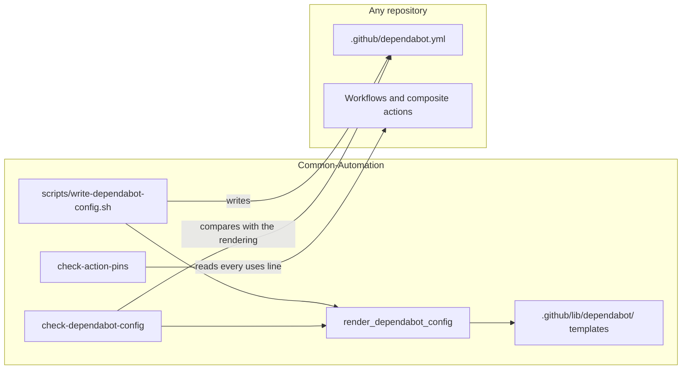

# Dependabot for Action Pins

Issue: [#128](https://github.com/Klark-Morrigan/Common-Automation/issues/128)

- [Problem](#problem)
  - [What the pins are today](#what-the-pins-are-today)
  - [What Dependabot costs](#what-dependabot-costs)
  - [What it must be](#what-it-must-be)
- [Solution approach](#solution-approach)
  - [Candidates](#candidates)
  - [Against the requirements](#against-the-requirements)
  - [Left out](#left-out)
- [Design](#design)
  - [The pieces](#the-pieces)
  - [The rendered file](#the-rendered-file)
  - [The config check](#the-config-check)
  - [The pin check](#the-pin-check)
  - [The writer](#the-writer)
  - [Rollout order](#rollout-order)
  - [Security](#security)

## Problem

Every action a workflow uses is pinned by hand, and nothing says when a pin falls behind,
so a pin moves only when someone happens to look.
Dependabot would open a pull request for each new release,
and each repository's existing gates would check it like any other change.

No repository on the Klark-Morrigan account has a `.github/dependabot.yml` today.

### What the pins are today

Twenty-one repositories on the account hold GitHub Actions workflows.
Their workflows and composite actions hold 158 `uses:` references:

| Reference | Count | Example | Moves when |
| --- | --- | --- | --- |
| Full commit SHA with a version comment | 39 | `actions/checkout@93cb6efe18208431cddfb8368fd83d5badbf9bfd # v5.0.1` | Someone edits it |
| `@master` of a Common-* repository | 110 | `Klark-Morrigan/Common-Automation/.github/workflows/ci-bash.yml@master` | Common-* merges to master |
| Floating major tag | 10 | `actions/checkout@v5` | The action's owner moves the tag |
| Release tag of a reusable workflow on the account | 2 | `Klark-Morrigan/Starsector-Mod-KMLib/.github/workflows/mod-release.yml@0.5.2` | Someone edits it |

The standing convention is the first row: a full commit SHA, since a tag can be moved under a pin.
The ten floating tags break it:

| Repository | File | References |
| --- | --- | --- |
| Common-DotNet | `.github/workflows/ci-dotnet.yml` | `actions/checkout@v5` three times, `actions/upload-artifact@v7` |
| Common-DotNet | `.github/actions/provision-dotnet-toolchain/action.yml` | `actions/setup-dotnet@v5` |
| Infrastructure-E2E | `.github/workflows/e2e.yml` | `actions/create-github-app-token@v3` |
| Infrastructure-GitHub, Infrastructure-HyperV, Infrastructure-Network-Windows, Infrastructure-Wsl | `.github/workflows/release.yml` | `actions/checkout@v5` |

None of them is meant to float: no comment beside them says so,
and Common-DotNet's own plan asks for pins by commit SHA.
Common-DotNet's README names its steps by tag too, and has already drifted:
it lists `actions/upload-artifact@v4` where the workflow holds `@v7`.

No list of the account's repositories exists to roll a change out from.
`.menu/supersets.psd1` lists repositories for graphify only, and five of the twenty-one are missing from it.

### What Dependabot costs

- **Adding it**: one `.github/dependabot.yml` in each repository.
- **Running it**: Dependabot's own jobs on standard GitHub-hosted runners
  [do not count against included Actions minutes](https://docs.github.com/en/code-security/concepts/supply-chain-security/dependabot-on-actions).
- **The pull requests' CI**: free on hosted runners for the seventeen public repositories.
  The four private ones spend minutes when their gates run on hosted runners, and nothing on self-hosted ones.
- **Review**: each pull request still needs a review and a merge.

### What it must be

- **Every repository**: each account repository with workflows is covered, twenty-one today,
  and a repository added later is covered without someone having to remember it.
- **One source**: the configuration is written once;
  twenty-one hand-kept copies would drift.
- **SHA pins stay SHA pins**: a bump moves the SHA and its version comment together.
- **No floating tags**: the ten above become SHA pins,
  since Dependabot keeps a reference in the form it finds it,
  and no README restates a pin that its workflow already holds.
- **`@master` left alone**: the calls into Common-* track the branch on purpose
  (see [Pinning](../../../../README.md#pinning)), and a bump must never pin them.
- **Releases at least two weeks old**: `cooldown: default-days: 14`,
  above Dependabot's default of three days.
- **Few pull requests**: one grouped pull request per repository per week at most.
- **Through the gates**: a bump merges only through the repository's existing pull request gates.
  Dependabot adds no check of its own.
- **Shares the file**: Common-Automation's `dependabot.yml` also carries the `npm` entry
  of the [Mermaid lint plan](../115-mermaid-lint/plan.md#the-image).
- **KMLib releases proposed**: the two references to KMLib's `mod-release.yml` pin a release tag on purpose,
  and a new KMLib release reaches them as a pull request, like any other action's.

## Solution approach

**Direction: Dependabot, plus a drift gate.**
Each repository holds a `dependabot.yml` generated from one template in Common-Automation,
and a check in the `ci-yaml` reusable workflow fails a repository whose copy is missing or differs.

- Dependabot is GitHub's own service, so no outside party gains write access to the account's repositories,
  private ones included.
- It meets every point of [What it must be](#what-it-must-be);
  the floating tags take one conversion by hand, and a pin check beside the drift gate keeps new ones out.
- What it costs over Renovate: the template, the drift check and their tests are code to own,
  and `versions.env` stays bumped by hand.

### Candidates

| | Dependabot, plus a drift gate | Renovate, through Mend's hosted app |
| --- | --- | --- |
| Source and steward | GitHub's own service; [dependabot-core](https://github.com/dependabot/dependabot-core) is MIT | [Renovate](https://github.com/renovatebot/renovate), AGPL-3.0, run by Mend; releases every few days |
| Price | Free; its jobs [use no Actions minutes](https://docs.github.com/en/code-security/concepts/supply-chain-security/dependabot-on-actions) | [Free](https://github.com/apps/renovate) for public and private repositories; runs on Mend's machines |
| What each repository holds | A full `dependabot.yml` | A one-line `renovate.json` naming a shared preset |
| One source | None built in: no `extends`, and YAML anchors fail to parse. The template lives in Common-Automation, and a check in the `ci-yaml` reusable workflow, which every repository calls at `@master`, fails a repository whose copy differs | The preset in one repository, `extends: ["github>Klark-Morrigan/<repository>"]`; a change there reaches every repository on its next run |
| Floating tags | Kept in the form found; converted by hand once, and the drift gate can refuse new ones | [`helpers:pinGitHubActionDigests`](https://docs.renovatebot.com/presets-helpers/) converts them and keeps the version comment |
| `@master` | Left alone: its [update checker](https://github.com/dependabot/dependabot-core/blob/main/github_actions/lib/dependabot/github_actions/update_checker.rb) updates a ref only when it looks like a version or a commit SHA | [Pinned to a commit](https://docs.renovatebot.com/modules/manager/github-actions/) unless the preset excludes `Klark-Morrigan/*` |
| Pins outside workflows | npm only; it cannot read `versions.env` or a Dockerfile `ARG` | npm, and [custom managers](https://docs.renovatebot.com/modules/manager/) can bump `versions.env` keys and the Dockerfile's `NODE_VERSION` |
| Security | First party: no outside service gains access | A third-party app with write access to code, pull requests and workflows in every repository it is installed on, private ones included |
| Build | The template, the drift check and its tests | The preset; no code |

### Against the requirements

| [Requirement](#what-it-must-be) | Dependabot, plus a drift gate | Renovate |
| --- | --- | --- |
| Every repository, including later ones | The drift gate fails a repository without the file, once it calls `ci-yaml` | Installed for all repositories, the app proposes its config to each new one |
| One source | Copies stay, but the gate catches drift | Yes |
| SHA pins stay SHA pins | Yes | Yes |
| No floating tags | One conversion by hand | Yes |
| `@master` left alone | Yes, with no rule | With a rule in the preset |
| Releases at least two weeks old | `cooldown: default-days: 14` | `minimumReleaseAge: "14 days"` |
| Few pull requests | `groups` | `groupName` and a weekly `schedule` |
| Through the gates | Yes | Yes |
| Shares the file with the Mermaid lint `npm` entry | Yes | Covers npm too, so the Mermaid lint plan would move to Renovate |
| KMLib releases proposed | Yes, since it updates reusable workflow refs | Yes |

### Left out

- **GitHub's [action lockfile](https://docs.github.com/en/actions/how-tos/secure-your-work/lock-workflow-dependencies)
  and [SHA pinning policy](https://github.blog/changelog/2025-08-15-github-actions-policy-now-supports-blocking-and-sha-pinning-actions/)**:
  a lockfile freezes a branch ref at its locked commit,
  and the policy fails a run that uses an unpinned action;
  25 `@master` references call composite actions on the account, in 8 files, and would stop tracking their branch or fail.
- **Renovate run by this repository**, through a scheduled workflow:
  as Renovate above, plus a token with write access to every repository kept in this repository's secrets.
- **A file-sync action** such as [repo-file-sync-action](https://github.com/BetaHuhn/repo-file-sync-action),
  which opens a pull request in each listed repository when the template changes:
  it needs a token with write access to every repository, and a hand-kept list of them, which a new repository is missing from.

## Design

### The pieces



The templates and the render function live under `.github/lib/dependabot/`,
since a consumer's CI checks out only `.github/actions` and `.github/lib` of Common-Automation.
The checks and the writer all call one render function, so they cannot disagree,
as plan 126's launcher check and writer share one.

### The rendered file

A repository's `dependabot.yml` is rendered from what it tracks, so no part of it is written by hand.

- **A header**: `version: 2`, and a comment saying the file is generated, naming the writer and the check.
- **One `github-actions` entry**: `directories` holds `/`, for the workflows and a root `action.yml`,
  and `/.github/actions/*` when the repository tracks a `.github/actions/<name>/action.yml`;
  [`directories` takes globs](https://docs.github.com/en/code-security/dependabot/working-with-dependabot/dependabot-options-reference).
- **One `npm` entry for each folder holding a tracked `package-lock.json`**,
  such as the [Mermaid lint plan](../115-mermaid-lint/plan.md#the-image)'s action folder.
- **Every entry alike otherwise**: `schedule: interval: weekly`, `cooldown: default-days: 14`,
  and one group whose pattern is `*`, so an entry opens one pull request a week at most.
- **No `ignore` rule**: `@master` refs get no update, and KMLib's release tags are updated as versions.

Common-Automation's rendering, once the Mermaid lint plan has landed:

```yaml
# Generated by scripts/write-dependabot-config.sh; check-dependabot-config fails on any hand edit.
version: 2
updates:
  - package-ecosystem: github-actions
    directories:
      - /
      - /.github/actions/*
    schedule:
      interval: weekly
    cooldown:
      default-days: 14
    groups:
      github-actions:
        patterns:
          - "*"
  - package-ecosystem: npm
    directory: /.github/actions/mermaid-lint
    schedule:
      interval: weekly
    cooldown:
      default-days: 14
    groups:
      npm:
        patterns:
          - "*"
```

### The config check

- `check-dependabot-config`, an action in the shape every action here takes,
  renders the file for the repository under check and compares it with `.github/dependabot.yml`,
  carriage returns stripped.
- A missing file fails, naming the writer's command.
  A different file fails, printing the difference.
- It runs as a step of `ci-yaml`'s job, which every repository with workflows calls at `@master`,
  so a repository created later is covered once it calls `ci-yaml`.
  Locally, the lint half runs the same script.

### The pin check

`check-action-pins` reads every `uses:` line in the tracked workflow files and `action.yml` files.

| A reference | Verdict |
| --- | --- |
| A local path, `./…` | Passes |
| A repository on the account, `Klark-Morrigan/…@<ref>` | Passes: `@master` by the [Pinning](../../../../README.md#pinning) convention, or a release tag |
| `<owner>/<repository>@<40 hex digits> # v<version>` | Passes |
| Anything else: a tag, a branch, a short SHA, a SHA without its version comment | Fails, naming the file, the line and the form expected |

The account name is a named constant in the check, since every repository it runs in belongs to the one account.
It runs beside the config check, in `ci-yaml` and in the lint half.

### The writer

`scripts/write-dependabot-config.sh` renders the file into a target repository,
named by `COMMON_AUTOMATION_TARGET_REPO` as the runners name theirs, and prints what it wrote.
It runs once per repository during the rollout,
and again when a repository's tracked files change its rendering:
its first composite action, or a new lockfile.

### Rollout order

Every repository calls `ci-yaml` at `@master`,
so a check wired into it applies to all of them at the merge.
The order keeps every gate green:

1. Common-Automation lands the templates, the render function, the writer and both checks, with their suites,
   and its own `dependabot.yml`; nothing calls the checks yet.
2. Each repository converts its floating tags and writes its file with the writer, in a pull request of its own.
   The repositories are those `gh repo list` shows on the account with a `.github/workflows` folder, once;
   after that, the gate keeps the list.
3. Common-Automation wires both checks into `ci-yaml` and the lint half.

### Security

- The checks only read; `ci-yaml`'s token stays `contents: read`.
- A Dependabot pull request runs the gates with a read-only token and no Actions secrets,
  so a bad release cannot reach a secret through them, and it still merges only after review.
- The cooldown keeps a release out for two weeks,
  so a compromised release caught within that window is never proposed.
