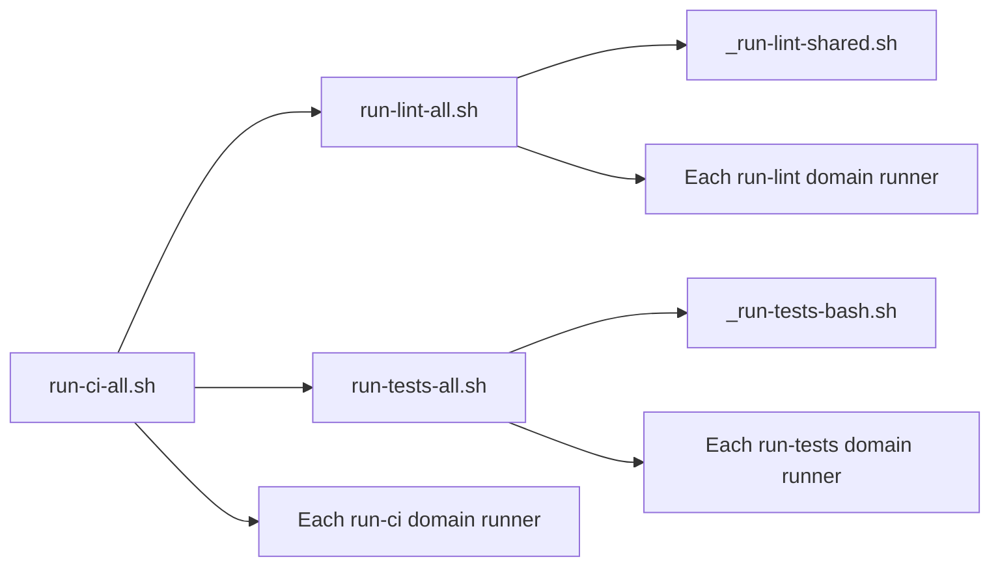
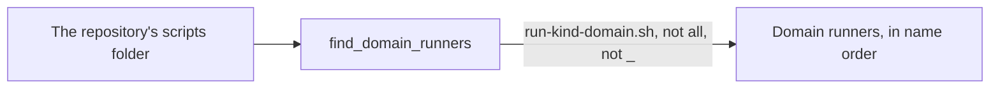
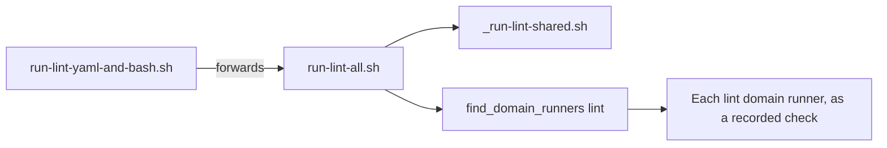
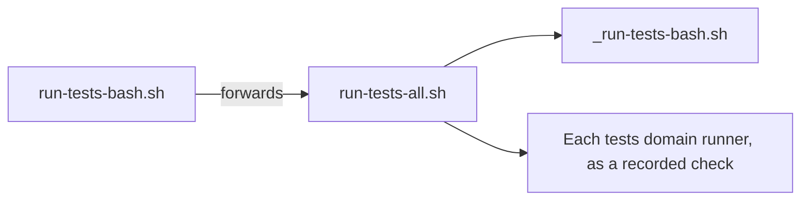
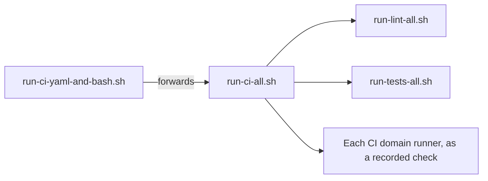
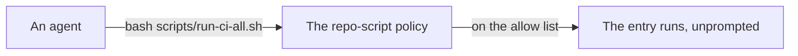
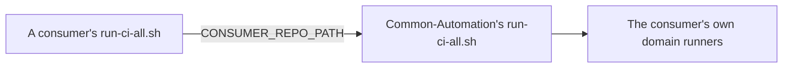
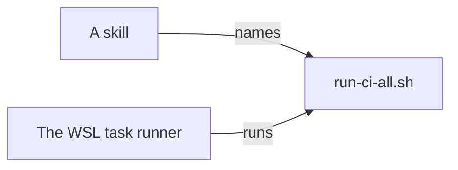

# Runner Script Names

Issue: [#129](https://github.com/Klark-Morrigan/Common-Automation/issues/129)

- [Problem](#problem)
  - [What the names say and what runs](#what-the-names-say-and-what-runs)
  - [Where the names reach](#where-the-names-reach)
  - [What it must be](#what-it-must-be)
- [Solution approach](#solution-approach)
  - [Naming candidates](#naming-candidates)
  - [Rollout candidates](#rollout-candidates)
  - [Recommendation](#recommendation)
- [Design](#design)
  - [What each entry runs](#what-each-entry-runs)
  - [Finding the domain runners](#finding-the-domain-runners)
  - [Consumer shims](#consumer-shims)
  - [Forwarders](#forwarders)
  - [Outside the repositories](#outside-the-repositories)
  - [Rollout order](#rollout-order)
- [Affected files](#affected-files)
- [Steps](#steps)
  - [1. The runners find a repository's domain runners by name](#1-the-runners-find-a-repositorys-domain-runners-by-name)
  - [2. run-lint-all.sh runs the shared lint, then every lint domain runner](#2-run-lint-allsh-runs-the-shared-lint-then-every-lint-domain-runner)
  - [3. run-tests-all.sh runs the bats suites, then every tests domain runner](#3-run-tests-allsh-runs-the-bats-suites-then-every-tests-domain-runner)
  - [4. run-ci-all.sh runs every lint and test, then every CI domain runner](#4-run-ci-allsh-runs-every-lint-and-test-then-every-ci-domain-runner)
  - [5. An agent runs the all entries without a permission prompt](#5-an-agent-runs-the-all-entries-without-a-permission-prompt)
  - [6. Every repository's shims run the all entries](#6-every-repositorys-shims-run-the-all-entries)
  - [7. The menu launches the all entries, labelled by what they run](#7-the-menu-launches-the-all-entries-labelled-by-what-they-run)
  - [8. The agent tooling's skills and task runner name the all entries](#8-the-agent-toolings-skills-and-task-runner-name-the-all-entries)
  - [9. The old runner names are gone](#9-the-old-runner-names-are-gone)

## Problem

The three local runner entry points are named for YAML and bash,
but they run every check Common-Automation's three CI workflows run, Markdown included.
A name no longer says what a run covers, and each new check widens the gap.

### What the names say and what runs

| Entry point | The name says | It runs |
| --- | --- | --- |
| `run-lint-yaml-and-bash.sh` | YAML and bash lint | shellcheck over four trees, check-sh-executable, actionlint, action-validator, yamllint, markdownlint |
| `run-tests-bash.sh` | bash tests | every bats suite git tracks |
| `run-ci-yaml-and-bash.sh` | CI for YAML and bash | both halves: the local equivalent of `ci-yaml`, `ci-markdown` and `ci-bash` |

The halves behind them, `_run-lint-yaml-and-bash.sh` and `_run-tests-bash.sh`, carry the same names.
Only `run-tests-bash.sh` says what it runs.

Planned work widens the gap:

- the [Mermaid lint plan](../115-mermaid-lint/plan.md) adds `mermaid-lint` to the lint half;
- the [shared batch launcher plan](../126-shared-bat-launcher/plan.md) adds `check-bat-launchers` to the lint half
  and a `windows tests` check to `run-ci-yaml-and-bash.sh`.

### Where the names reach

- **Consumer shims**: 21 repositories carry all three entry points as shims that delegate here,
  each a `.sh` with its `.bat` launcher,
  and most of those repositories' READMEs name them.
- **This repository**: the runners and their suites, the README,
  the header comments of five action scripts and the `test-bats` action,
  and the open plans 115, 126 and 127.
- **Domain runners beside them**: `run-ci-gradle.sh`, `run-ci-dotnet.sh` and `run-lint-ansible.sh`
  sit in the same `scripts/` folders and follow a `run-<ci|lint>-<domain>` shape,
  and some of them call these runners.
- **The `.menu`**: its rows label and launch them,
  and their labels already list fewer checks than run:
  "yamllint, actionlint, action-validator, shellcheck".
- **The agent tooling**: its repo-script allow list names `run-ci-yaml-and-bash` and `run-lint-yaml-and-bash`,
  and its repo-script policy, several skills and the WSL task runner name them too.

### What it must be

- **Says what runs**: each name says what its run covers,
  and stays true when a check is added;
  a name that lists tools goes stale with the next tool.
- **Fits beside the domain runners**: the names sit in one `scripts/` folder
  with `run-ci-gradle.sh` and the others, read as the same family, and collide with none.
- **One rename everywhere**: every shim, launcher, README, `.menu` row and agent tooling reference moves,
  and no repository is left calling a name that no longer exists.
- **No broken window**: a consumer's shim delegates to this repository's master,
  so no consumer's shim fails at any point during the rollout.
- **Agents unprompted throughout**: the allow list covers each new name before an old one goes.
- **After the launcher template**: plan 126 renders every launcher from one template by name,
  so the rename lands after it and changes the template once, not 21 launchers by hand.

## Solution approach

**Direction: `all` names in the family's own shape, rolled out through forwarders.**

| Today | Renamed |
| --- | --- |
| `run-lint-yaml-and-bash.sh` | `run-lint-all.sh` |
| `run-tests-bash.sh` | `run-tests-all.sh` |
| `run-ci-yaml-and-bash.sh` | `run-ci-all.sh` |
| `_run-lint-yaml-and-bash.sh` | `_run-lint-shared.sh` |
| `_run-tests-bash.sh` | `_run-tests-bash.sh`, unchanged |

- **What makes `all` true**: an `all` entry runs every local check of its kind that its repository has,
  its domain runners included.
  Consumer lint shims already work this way: those with Ansible content run `run-lint-ansible.sh` after the shared lint.
  `run-ci-all.sh` in a repository with `run-ci-gradle.sh` runs that too.
  Beside the domain runners, a bare `all` that ran only the shared checks would read as more than it is;
  under this contract it is exactly what it says.
- **The halves keep a narrow name**: `_run-lint-shared.sh` is the shared part every `all` entry starts from,
  and `_run-tests-bash.sh` already says what it runs.
- **Forwarders**: each old entry name stays as a forwarder that names its replacement and runs it,
  until no caller is left.
- **Why not `shared`**: it names only Common-Automation's part,
  so a repository with domain runners would still need a name for the whole run.

### Naming candidates

| | Scripts to Rule Them All | A task runner: [Task](https://taskfile.dev), [just](https://github.com/casey/just) or Make | Names in the family's own shape |
| --- | --- | --- | --- |
| What it is | GitHub's [normalized script pattern](https://github.blog/engineering/engineering-principles/scripts-to-rule-them-all/): `script/test`, `script/cibuild` and others, one per purpose, in every repository | Targets in one file, such as `task lint` or `just ci` | `run-<ci\|lint\|tests>-<domain>.sh`, as `run-ci-gradle.sh` already is |
| Source and licence | A convention; the [boilerplate](https://github.com/github/scripts-to-rule-them-all) is listed as CC0 | Task MIT, just CC0, Make GPL-3.0; all maintained | None needed |
| Fit | Names say the purpose and never go stale, but `script/test` would own every test in a repository, the domain runners' included: a wider change than this one | Names say the purpose; the file lists every check | Fits beside the domain runners with no new tool |
| Cost | Moves `scripts/` to `script/`, drops the extension, and reworks the domain runners | A binary on every workstation and runner, against the family's Docker-only tooling; the double-click launchers lose their target | Only the rename |
| Security | Nothing new | A new binary in every CI job, from a third party | Nothing new |

Within the family's own shape, two readings of what these runners cover:

- **What they do**: `run-lint.sh`, `run-tests.sh`, `run-ci.sh`.
  Short, but beside `run-ci-gradle.sh` a bare `run-ci.sh` reads as all of a repository's CI, which it is not.
- **Whose checks they are**: the checks every repository shares, supplied by this one:
  `run-lint-shared.sh` and `run-ci-shared.sh`, with `run-tests-bash.sh` kept, since it already says what it runs.
  The domain is `shared`, so the names read as one family with `run-ci-gradle.sh`,
  and they stay true as shared checks are added.

### Rollout candidates

| | Forwarders, then removal | Everything in one pass |
| --- | --- | --- |
| How | This repository adds the new names and turns each old one into a forwarder that names its replacement and runs it; consumers move one at a time; a last step removes the forwarders once no caller is left | Every repository renames on the same day |
| No broken window | Yes: an old shim keeps working until its repository moves | Only if every repository merges in the right order |
| Agents unprompted | The allow list gains the new names first and loses the old ones last | Needs the allow list changed in the same pass |
| Cost | One extra step at each end | One coordinated push across 21 repositories |

### Recommendation

Names in the family's own shape, with no new tool,
rolled out through forwarders,
with each consumer's launchers regenerated from plan 126's template.
The direction above settles the word: `all`, under the contract it states.

## Design

### What each entry runs

| Entry | Runs, in order |
| --- | --- |
| `run-lint-all.sh` | `_run-lint-shared.sh`, then every `run-lint-<domain>.sh` the repository has |
| `run-tests-all.sh` | `_run-tests-bash.sh`, then every `run-tests-<domain>.sh` |
| `run-ci-all.sh` | `run-lint-all.sh`, `run-tests-all.sh`, then every `run-ci-<domain>.sh` |

- Each domain runner runs as one recorded check under its own heading,
  so a run still ends by naming every check that failed.
- A domain offers either `run-ci-<domain>.sh`,
  or `run-lint-<domain>.sh` and `run-tests-<domain>.sh`, never both,
  so no check runs twice.
  Today's domain runners keep to this: Gradle and .NET are `run-ci-`, Ansible is `run-lint-`.
- A domain runner never calls an `all` entry, so the composition cannot loop.

### Finding the domain runners

- Common-Automation's entries find them in the consumer repository's `scripts/`
  by the pattern `run-<kind>-<domain>.sh`, in name order.
- `all` and any name starting with `_` are not domains.
- A new domain runner joins its `all` entry by being named to the pattern; no list is edited.
- Consumer lint shims stop calling `run-lint-ansible.sh` themselves, since the entry now finds it.

### Consumer shims

- Every consumer shim becomes the same three lines:
  set `CONSUMER_REPO_PATH` to its repository, then run Common-Automation's entry of the same name.
- No shim names a domain runner, so the shims match across repositories.
- The `.bat` launchers are rendered by [plan 126](../126-shared-bat-launcher/plan.md)'s writer,
  once for the new names and once for the forwarders.

### Forwarders

- Each old entry name, in Common-Automation and in every consumer, becomes a forwarder:
  it prints `<old name> is renamed <new name>; run that instead.` to stderr, then runs the new entry with its arguments,
  and exits with its code.
- The notice goes to stderr, so a caller reading stdout sees the same output as before.
- The forwarders go in a last step, once a search of every repository, the `.menu` and the agent tooling finds no caller.

### Outside the repositories

- **The `.menu`**: its rows launch the new names,
  and its labels say what runs without listing tools, such as "Lint: every check, shared and this repository's own".
- **The agent tooling**: the repo-script allow list gains `run-ci-all`, `run-lint-all` and `run-tests-all`
  before any caller moves,
  and loses the old names with the forwarders;
  the skills and the WSL task runner name the new entries.
  The settings files are protected, so the agent writes the change and the user approves it.

### Rollout order

Consumer shims call Common-Automation's master, so the order keeps every call working:

1. Common-Automation adds the new entries, the domain-runner finding and its own forwarders.
2. The agent tooling's allow list gains the new names.
3. Each repository moves its shims to the new names, keeps forwarders under the old ones,
   and drops its own call to a domain runner; one pull request each.
4. The `.menu` and the agent tooling move to the new names.
5. Every forwarder is removed, and the allow list loses the old names.

## Affected files

In Common-Automation:

| File | Change |
| --- | --- |
| [README.md](../../../../README.md) | Running checks locally names the `all` entries and the domain-runner contract; the Layout tree follows the renames |
| [scripts/_run-lint-yaml-and-bash.sh](../../../../scripts/_run-lint-yaml-and-bash.sh) and its `.bats` | Renamed `_run-lint-shared.sh`, a forwarder left under the old name |
| [scripts/run-lint-yaml-and-bash.sh](../../../../scripts/run-lint-yaml-and-bash.sh), [run-tests-bash.sh](../../../../scripts/run-tests-bash.sh), [run-ci-yaml-and-bash.sh](../../../../scripts/run-ci-yaml-and-bash.sh), their `.bats` and `.bat` | Forwarders to the `all` entries, then removed |
| The header comments of five action scripts and the `test-bats` action | Name `_run-lint-shared.sh` and `_run-tests-bash.sh` |

New in Common-Automation: `scripts/_find-domain-runners.sh`,
and `scripts/run-lint-all.sh`, `run-tests-all.sh` and `run-ci-all.sh`, each with its `.bats` and `.bat`.

Elsewhere:

- every repository with shims: the shims, their launchers and its README;
- the `.menu`: its rows and labels;
- the agent tooling: the repo-script allow list and its policy suite, the skills and the WSL task runner that name the runners.

## Steps

Every step lands with its own tests and with the README text its change makes true;
a step is not done without them.

### 1. The runners find a repository's domain runners by name

**Problem.** The `all` entries need the domain runners a repository has, and nothing lists them.

**Solution.** `scripts/_find-domain-runners.sh`, sourced, defines `find_domain_runners <repository> <kind>`:
it prints the paths [Finding the domain runners](#finding-the-domain-runners) sets out, one per line, in name order.

**Verification** (`scripts/_find-domain-runners.bats`, a new suite, 5 s: every case lists one temp folder).
Given `scripts/` holding `run-lint-ansible.sh`, `run-lint-all.sh`, `_run-lint-shared.sh` and `run-ci-gradle.sh`,
when it finds the `lint` runners, then it prints `run-lint-ansible.sh` alone.

**Test cases** (`scripts/_find-domain-runners.bats`):

- Given `run-ci-gradle.sh` and `run-ci-dotnet.sh`, when it finds `ci`, then both, `dotnet` first.
- Given no domain runner, then nothing, and exit 0.
- Given `run-lint-ansible.bat` with no `.sh`, then nothing.
- Given a repository with no `scripts/` folder, then nothing, and exit 0.

### 2. run-lint-all.sh runs the shared lint, then every lint domain runner

**Problem.** A full lint run means knowing which domain runners a repository has.

**Solution.**

- `scripts/_run-lint-yaml-and-bash.sh` moves to `scripts/_run-lint-shared.sh` through the move-with-references skill,
  which repoints its suite and the action scripts' header comments.
- `scripts/run-lint-all.sh` runs `_run-lint-shared.sh`, then each runner `find_domain_runners` gives for `lint`,
  each as a recorded check under its own heading.
- `run-lint-yaml-and-bash.sh` and `_run-lint-yaml-and-bash.sh` become [forwarders](#forwarders).
- The README's Running checks locally names `run-lint-all.sh` and the contract.

**Verification** (`scripts/run-lint-all.bats`, a new suite, 15 s: every case runs the entry with stubbed halves).
Given a consumer repository holding a failing stub `run-lint-ansible.sh`,
when `run-lint-all.sh` runs, then `=== run-lint-ansible ===` follows the shared checks
and the summary names it as failed.

**Test cases**:

- `scripts/run-lint-all.bats`:
  - given no domain runner, then only the shared checks run;
  - given every check passes, then exit 0.
- `scripts/run-lint-yaml-and-bash.bats`, rewritten for the forwarder, 2 s a case:
  - given any arguments, then `run-lint-all.sh` gets them unchanged;
  - given `run-lint-all.sh` exits 1, then the forwarder exits 1;
  - given a run, then stderr holds the rename notice and stdout holds none of it.

### 3. run-tests-all.sh runs the bats suites, then every tests domain runner

**Problem.** The tests entry is named for bats alone and runs nothing else.

**Solution.**

- `scripts/run-tests-all.sh` runs `_run-tests-bash.sh`, then each `tests` domain runner as a recorded check.
- `run-tests-bash.sh` becomes a forwarder.
- The README names `run-tests-all.sh`.

**Verification** (`scripts/run-tests-all.bats`, a new suite, 15 s: every case runs the entry with a stubbed half).
Given a consumer repository holding a stub `run-tests-pester.sh`,
when `run-tests-all.sh` runs, then `=== run-tests-pester ===` follows the bats run.

**Test cases**:

- `scripts/run-tests-all.bats`: given no domain runner, then only the bats run.
- `scripts/run-tests-bash.bats`, rewritten for the forwarder: the same three cases as step 2's forwarder.

### 4. run-ci-all.sh runs every lint and test, then every CI domain runner

**Problem.** A repository with `run-ci-gradle.sh` needs two commands for a full local run.

**Solution.**

- `scripts/run-ci-all.sh` runs `run-lint-all.sh`, `run-tests-all.sh`, then each `ci` domain runner as a recorded check.
- `run-ci-yaml-and-bash.sh` becomes a forwarder.
- The README names `run-ci-all.sh` as the one entry for a full local run.

**Verification** (`scripts/run-ci-all.bats`, a new suite, 15 s: every case runs the entry with stubbed entries).
Given a consumer repository holding a stub `run-ci-gradle.sh`,
when `run-ci-all.sh` runs, then it runs after the lint and test entries, under its own heading.

**Test cases**:

- `scripts/run-ci-all.bats`:
  - given the lint entry fails, then the tests and the domain runners still run, and the summary names the lint entry;
  - given no domain runner, then only the two entries run.
- `scripts/run-ci-yaml-and-bash.bats`, rewritten for the forwarder: the same three cases as step 2's forwarder.

### 5. An agent runs the all entries without a permission prompt

**Problem.** The repo-script allow list names only the old entries.

**Solution.** In the agent tooling, outside this repository:
the repo-script allow list gains `run-ci-all`, `run-lint-all` and `run-tests-all`, beside the old names.
The settings files are protected, so the agent writes the change and the user approves it.

**Verification** (the repo-script policy's bats suite, 2 s a case).
Given `bash scripts/run-ci-all.sh` from a repository's root, when the policy reads it, then it allows it.

**Test cases** (the repo-script policy's bats suite): the same for `run-lint-all` and `run-tests-all`.

### 6. Every repository's shims run the all entries

**Problem.** The 21 consumers still call the old names, through the forwarders.

**Solution.** In each repository with shims, one pull request each:

- `run-lint-all.sh`, `run-tests-all.sh` and `run-ci-all.sh` as [the three-line shims](#consumer-shims);
- the old shim names as forwarders to them;
- no shim calls a domain runner itself, so a lint shim's own `run-lint-ansible.sh` call goes;
- the launchers rendered by plan 126's writer;
- the README names the new entries.

**Verification.** `scripts/run-ci-all.sh` in each repository passes,
and in a repository with Ansible content `=== run-lint-ansible ===` appears once.

**Test cases.** None in the consumers: the shims hold no logic, and steps 2 to 4 test what they call.

### 7. The menu launches the all entries, labelled by what they run

**Problem.** The `.menu` rows launch the old names, and their labels list fewer checks than run.

**Solution.** In the `.menu`, outside this repository:
each row launches its `all` entry,
labelled by what it runs, as [Outside the repositories](#outside-the-repositories) sets out.

**Verification** (the `.menu`'s Pester suites).
Given the menu's rows, when the suites run, then every row's script exists in its repository.

**Test cases** (the `.menu`'s Pester suites): the label test expects the new labels.

### 8. The agent tooling's skills and task runner name the all entries

**Problem.** Skills and the WSL task runner still tell an agent to run the old names.

**Solution.** In the agent tooling, outside this repository:
every skill and the WSL task runner name the `all` entries.

**Verification** (the WSL task runner's bats suite).
Given a repository, when its run-tests task runs, then it calls `run-tests-all.sh`.

**Test cases** (the WSL task runner's bats suite): its usage text names the new entry.

### 9. The old runner names are gone

**Problem.** The forwarders are only there for callers that have not moved.

**Solution.**

- A search of every repository on the account, the `.menu` and the agent tooling finds no caller of an old name
  outside landed plans and history.
- Every forwarder and its launcher is removed, in Common-Automation and in every consumer.
- The allow list loses the old names.
- Open plans that name an old entry name the new one.

**Verification.** `scripts/run-ci-all.sh` passes in every repository,
and the search finds no old name outside landed plans and history.

**Test cases.** The forwarder cases leave with their forwarders; nothing else changes.
